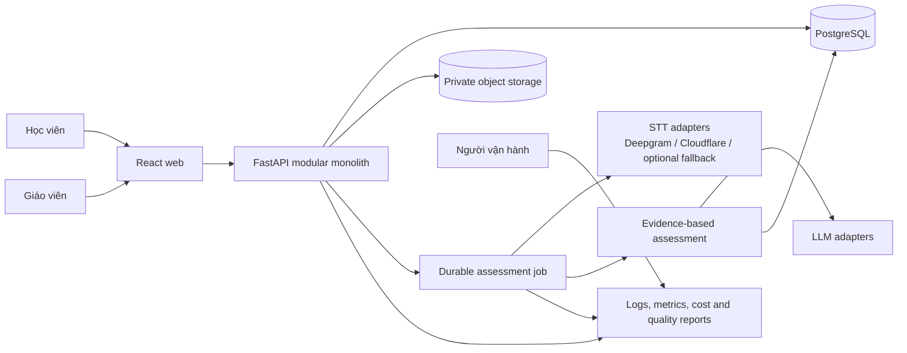

# Learn4 — Tài liệu Architectural Drivers

| Thuộc tính | Giá trị |
| --- | --- |
| Hệ thống quan tâm | Learn4, ưu tiên miền IELTS Speaking |
| Phiên bản tài liệu | 1.0 |
| Trạng thái | Baseline kiến trúc để review và ra quyết định |
| Ngày | 2026-10-21 |
| Chủ sở hữu | Product Owner và Architecture Owner của Learn4 |
| Phạm vi quyết định | Beta công khai, migration khỏi máy cá nhân, và điều kiện sẵn sàng thương mại |

## 1. Mục đích và cách sử dụng

Tài liệu này xác định các yếu tố chi phối kiến trúc của Learn4: mục tiêu kinh doanh, stakeholder,
concern, chức năng trọng yếu, thuộc tính chất lượng, ràng buộc, giả định và rủi ro. Nó trả lời
**hệ thống phải tối ưu điều gì và vì sao**; các quyết định triển khai cụ thể cần được ghi trong
Architecture Decision Record (ADR) và truy vết về driver tương ứng.

Tài liệu dùng khái niệm stakeholder, concern và architecture description theo
[ISO/IEC/IEEE 42010:2022](https://www.iso.org/standard/74393.html). Quality attribute scenario
dùng cấu trúc sáu phần của SEI: **nguồn kích thích, kích thích, môi trường, artifact bị tác động,
phản hồi và thước đo phản hồi**. Cấu trúc này làm cho yêu cầu phi chức năng có thể kiểm thử,
thay vì chỉ dùng các từ mơ hồ như “nhanh”, “chính xác” hoặc “ổn định”.

Đây là tài liệu driver, không phải tài liệu mô tả toàn bộ kiến trúc. Bản đồ runtime và module đang
có nằm tại [current-system.md](current-system.md); nghiên cứu hạ tầng nằm tại
[zero-cost-production-backend-hosting-2026.md](../research/zero-cost-production-backend-hosting-2026.md).

### 1.1 Quy ước trạng thái

- **C — Confirmed:** đã được xác nhận bởi yêu cầu sản phẩm hoặc code hiện hành.
- **P — Proposed:** mục tiêu đề xuất để kiến trúc và kiểm thử có điểm đích; Product Owner phải duyệt.
- **TBR — To Be Ratified:** đã có cách đo nhưng ngưỡng cần baseline bằng dữ liệu thật trước khi khóa.
- **Gap:** năng lực cần có nhưng chưa được triển khai đầy đủ.

Các con số P/TBR không được báo cáo như SLO đã đạt.

## 2. System of interest và phạm vi

Learn4 là nền tảng học tiếng Anh gồm quản lý lớp, bài tập, bài nộp, Writing và IELTS Speaking.
Trọng tâm kiến trúc của giai đoạn này là Speaking vì luồng này có rủi ro kỹ thuật và sản phẩm cao
nhất: nhận audio, nhận dạng lời nói, hiểu ngữ cảnh, chấm bốn tiêu chí, sinh feedback có bằng chứng,
lưu lịch sử và vận hành qua nhiều nhà cung cấp AI.

### 2.1 Trong phạm vi

- Speaking Practice và Mock Test ba Part.
- Audio ingestion, lưu trữ, retention và xử lý bằng `ffmpeg`.
- ASR nhiều provider, transcript nguyên văn, uncertainty và contextual review.
- Chấm Fluency & Coherence, Lexical Resource, Grammatical Range & Accuracy, Pronunciation.
- Feedback ngắn gọn, có bằng chứng, correction và khả năng nghe lại đúng đoạn.
- Job assessment bền vững, lịch sử, progress, observability và quản trị chi phí.
- Migration FastAPI/database/storage khỏi MacBook sang hạ tầng beta.
- Khả năng tích hợp vào luồng lớp học và teacher review sau này.

### 2.2 Ngoài phạm vi của baseline này

- Tuyên bố điểm chính thức thay mặt IELTS hoặc cam kết tương đương examiner khi chưa validation.
- Huấn luyện ASR bằng band/feedback của examiner; ASR chỉ học từ audio và transcript nguyên văn.
- Attendance, billing người học, marketplace và native mobile app.
- Azure Speech Pronunciation Assessment trong giai đoạn hiện tại.
- Admin, account-based RBAC và teacher approval như năng lực đã hoàn tất; đây là roadmap/gap.

### 2.3 Context hiện tại và context mục tiêu

Ở deployment đang được dùng tại ngày lập tài liệu, frontend Vercel chuyển request qua public
tunnel tới FastAPI chạy trên MacBook. Speaking job dùng worker thread trong process và có đường
lưu audio job ở filesystem local. Cloudflare Worker đã đảm nhiệm một adapter STT, chưa thay thế
FastAPI, database hay job runner. Vì vậy BG-02 và QA-05 chưa được thỏa mãn.

Context mục tiêu của beta:

Frontend và backend giao tiếp qua contract `speaking-v3`. Provider là adapter tại seam STT/LLM;
caller không được phụ thuộc response riêng của từng hãng. Audio bền vững nằm trong private object
storage; filesystem của compute chỉ là vùng tạm trong thời gian xử lý.

## 3. Mục tiêu kinh doanh

| ID | Mục tiêu | Chỉ báo thành công | Ưu tiên | Trạng thái |
| --- | --- | --- | --- | --- |
| BG-01 | Tạo sản phẩm luyện IELTS Speaking đủ tin cậy để người học hành động theo feedback | Feedback claim được kiểm chứng, band được calibration, tỷ lệ khiếu nại/sửa tay được theo dõi | Rất cao | C/TBR |
| BG-02 | Trình diễn sản phẩm mà không phụ thuộc MacBook và chưa phát sinh phí hosting cố định | Demo hoạt động trên hạ tầng cloud trong quota miễn phí; MacBook tắt vẫn sử dụng được | Rất cao | C |
| BG-03 | Rút ngắn vòng lặp luyện tập | Người học ghi âm, nhận kết quả, nghe lại lỗi và biết một hành động tiếp theo trong cùng phiên | Cao | C |
| BG-04 | Có đường nâng cấp sang sản phẩm thương mại mà không viết lại assessment core | Compute, database, storage và provider có adapter/seam rõ; migration giữ contract | Cao | C |
| BG-05 | Kiểm soát chi phí AI theo lượt chấm | Ghi nhận cost/usage theo job, có quota và degradation policy, không retry vô hạn | Cao | C |
| BG-06 | Xây dựng dữ liệu đánh giá có quyền sử dụng và giá trị lâu dài | Audio có consent; nhãn ASR và nhãn examiner tách biệt; split theo speaker/session | Cao | P |

## 4. Stakeholder và concern

| Stakeholder | Concern cần được kiến trúc xử lý |
| --- | --- |
| Học viên | Transcript phản ánh điều đã nói; lỗi/sửa dễ hiểu; không bị phán sai do ASR; kết quả nhanh; audio riêng tư; có thể thử lại |
| Giáo viên/IELTS reviewer | Nghe được audio gốc và đoạn evidence; phân biệt đề xuất AI với kết luận đã duyệt; override có audit; rubric nhất quán |
| Product Owner | Chất lượng đủ để bán, trải nghiệm chuyên nghiệp, chi phí có kiểm soát, roadmap rõ và không tạo claim pháp lý sai |
| Architecture/Engineering | Module có interface nhỏ; provider thay được; contract versioned; job idempotent; migration và rollback an toàn |
| ML/Assessment owner | Dataset đúng mục đích; metric theo slice; không leakage; model/rubric/calibration có version và provenance |
| Operations | Readiness phản ánh dependency thật; quan sát được latency/error/quota; không phụ thuộc process hoặc disk tạm |
| Security/Privacy owner | Secret không tới browser/log; audio private; retention/deletion; least privilege; incident traceability |
| Nhà cung cấp cloud/AI | Request đúng quota, format, timeout và điều khoản sử dụng; lỗi upstream không gây retry storm |

## 5. Functional drivers

Chỉ các chức năng làm thay đổi cấu trúc hệ thống hoặc có rủi ro cao mới được liệt kê ở đây.

| ID | Functional driver | Mức | Tiêu chí hoàn tất kiến trúc |
| --- | --- | --- | --- |
| FD-01 | Thu, kiểm tra và chuẩn hóa audio Practice/Mock | Must | Chặn file sai loại/quá giới hạn; giữ duration/checksum; xử lý tạm thời an toàn |
| FD-02 | Tạo và thực thi assessment job bền vững | Must | Job có trạng thái, attempt, idempotency key; restart/retry không làm mất hoặc nhân đôi kết quả |
| FD-03 | Nhận dạng đa nguồn và giữ transcript nguyên văn | Must | Lưu candidate/provider/provenance, word timestamp và uncertainty; không tự sửa mất lỗi nói thật |
| FD-04 | Review transcript theo câu hỏi và ngữ cảnh | Must | Phân biệt `raw`, `reviewed` và `suggested correction`; chỉ sửa khi đủ evidence, còn lại yêu cầu nghe lại |
| FD-05 | Đánh giá bốn tiêu chí theo rubric có version | Must | Mỗi criterion có status, nullable band, evidence IDs, feedback và provenance; overall chỉ có khi đủ điều kiện |
| FD-06 | Trình bày feedback chuyên nghiệp và có thể hành động | Must | Hiển thị “nghe được → gợi ý đúng” bằng mũi tên, lý do ngắn, replay segment và một ưu tiên luyện tiếp |
| FD-07 | Hoàn thành Mock theo toàn session | Must | Tổng hợp evidence giữa Part 1–3; không lấy trung bình máy móc theo số turn; nêu coverage/missing |
| FD-08 | Lưu history/progress có thể so sánh | Should | Chỉ so sánh kết quả cùng rubric/model/calibration hoặc giải thích khác phiên bản; null không thành 0 |
| FD-09 | Cho phép learner xác nhận transcript không chắc | Should | Sửa transcript được lưu riêng, có audit và không làm thay đổi audio gốc |
| FD-10 | Teacher review, approve/release hoặc yêu cầu thu lại | Should/Gap | AI score và teacher-approved score tách biệt; mọi override có actor/time/reason |
| FD-11 | Quản lý retention và quyền xóa dữ liệu | Must trước thương mại | Xóa object và metadata liên quan theo policy; có bằng chứng thực thi |
| FD-12 | Thu telemetry chất lượng/chi phí mà không lộ nội dung nhạy cảm | Must | Correlation ID xuyên pipeline; metric mặc định không chứa raw audio/transcript |

## 6. Quality attribute scenarios

### QA-01 — Validity và fidelity của transcript

| Thành phần | Đặc tả |
| --- | --- |
| Nguồn kích thích | Học viên Việt Nam nói tiếng Anh, có tên riêng, filler, lặp, false start hoặc lỗi ngữ pháp thật |
| Kích thích | Nộp audio hợp lệ cho một câu hỏi IELTS Speaking |
| Môi trường | Production bình thường; audio có thể có accent, codec điện thoại và nhiễu vừa phải |
| Artifact | Audio pipeline, STT ensemble và transcript review |
| Phản hồi | Giữ raw candidate; đối chiếu candidate độc lập và context; tạo reviewed transcript; đánh dấu span không chắc; không biến câu sai thành câu mẫu |
| Thước đo | TBR trên held-out speakers: raw/normalized WER, content-word deletion, grammar-error/filler preservation, proper-name recall, correction precision và silence hallucination rate. Mọi metric phải báo theo accent/device/noise/Part |

**Acceptance gate đề xuất:** contextual correction precision ≥ 95%; grammar-error/filler preservation
≥ 95%; silence clip không sinh transcript ≥ 99%. Các ngưỡng này là P/TBR và phải được khóa sau
pilot có nhãn, không được suy ra từ vài bản ghi demo.

### QA-02 — Validity của assessment và feedback

| Thành phần | Đặc tả |
| --- | --- |
| Nguồn kích thích | Học viên yêu cầu chấm một câu hoặc toàn bài Mock |
| Kích thích | Transcript/evidence có chất lượng khác nhau, kể cả thiếu hoặc mâu thuẫn |
| Môi trường | Provider hoạt động bình thường hoặc một phần evidence không đủ |
| Artifact | Evidence gate, criterion raters, validator, calibration và result contract |
| Phản hồi | Chấm riêng bốn tiêu chí; ràng mỗi claim vào evidence; trả `partial/needs_review/insufficient_evidence` và band `null` khi không đủ căn cứ; sinh feedback tiếng Việt ngắn và hành động cụ thể |
| Thước đo | Trên test set double-rated: MAE, QWK và bias theo criterion; within ±0.5; coverage/abstention; feedback-claim precision; unsupported-claim rate; inter-rater agreement được báo cùng kết quả |

**Acceptance gate đề xuất:** unsupported-claim rate ≤ 2%; ≥ 90% lỗi được hai reviewer xác nhận;
criterion MAE ≤ 0.5 và không có slice chính lệch trung bình quá 0.5 band. Đây là mục tiêu P/TBR,
không phải tuyên bố chất lượng hiện tại.

### QA-03 — Pronunciation integrity

| Thành phần | Đặc tả |
| --- | --- |
| Nguồn kích thích | Audio có từ ASR không chắc hoặc transcript khác từ người học định nói |
| Kích thích | Pipeline chuẩn bị tạo lỗi phát âm hoặc Pronunciation band |
| Môi trường | Chưa có phone-level evidence đã validation hoặc alignment thất bại |
| Artifact | Pronunciation module và result validator |
| Phản hồi | Không suy lỗi phát âm từ text/ASR confidence; trả criterion `insufficient_evidence` hoặc coaching được gắn nhãn; cho nghe lại vùng nghi ngờ |
| Thước đo | 100% pronunciation error có audio span và evidence type hợp lệ; 0 band được tạo chỉ từ transcript; alignment/claim precision được đánh giá riêng trước khi bật chấm |

### QA-04 — Performance và responsiveness

| Thành phần | Đặc tả |
| --- | --- |
| Nguồn kích thích | Học viên nộp audio; sau idle hệ thống có thể đang scale-to-zero |
| Kích thích | Tạo job, upload, poll và mở kết quả |
| Môi trường | Beta free-tier; warm và cold start được đo riêng |
| Artifact | Web, API, object storage, job runner, STT và LLM adapters |
| Phản hồi | Xác nhận upload/job nhanh; hiển thị trạng thái thật; hoàn tất hoặc trả lỗi có thể retry, không treo vô hạn |
| Thước đo | P95 tạo job ≤ 2 giây khi warm; P95 thời gian assessment audio ≤ 2 phút: ≤ 45 giây warm và ≤ 120 giây cold; 100% job có deadline; UI cập nhật status trong ≤ 3 giây sau poll thành công |

Ngưỡng là P/TBR. Audio Mock dài được đo riêng; không gộp cold start vào latency model như thể đó
là lỗi scoring.

### QA-05 — Reliability, recoverability và data integrity

| Thành phần | Đặc tả |
| --- | --- |
| Nguồn kích thích | Runtime/provider/database restart, timeout hoặc gửi task trùng |
| Kích thích | Job bị gián đoạn giữa upload, STT, scoring hoặc commit |
| Môi trường | Vận hành bình thường và sự cố một dependency |
| Artifact | Job orchestration, database transaction và object storage |
| Phản hồi | Retry có giới hạn; claim job atomically; xử lý idempotent; không ghi đè kết quả đã hoàn tất; chuyển terminal state có lý do; cho phép replay an toàn |
| Thước đo | 0 acknowledged job bị mất trong fault test; 0 duplicate result; ≥ 99% job hợp lệ đạt terminal state trong 5 phút ở beta; recovery test bao phủ crash trước/sau mỗi side effect |

### QA-06 — Availability và graceful degradation

| Thành phần | Đặc tả |
| --- | --- |
| Nguồn kích thích | STT/LLM provider hết quota, 429, timeout hoặc unavailable |
| Kích thích | Một dependency không phục vụ request |
| Môi trường | Production có traffic bình thường |
| Artifact | Provider adapters, policy engine và readiness |
| Phản hồi | Circuit-break/retry có jitter theo policy; dùng provider khác nếu được phép; nếu evidence giảm thì giảm scope hoặc abstain; báo trạng thái rõ, không dùng mock |
| Thước đo | 100% fallback ghi actual provider/model; 0 mock result trong production; retry không vượt cấu hình; `/ready` phản ánh dependency bắt buộc; lỗi quota không tạo retry storm |

### QA-07 — Security và privacy

| Thành phần | Đặc tả |
| --- | --- |
| Nguồn kích thích | Người dùng trái phép, URL bị chia sẻ, log/error hoặc dependency bị lạm dụng |
| Kích thích | Truy cập audio/result, upload nội dung, gọi task endpoint hoặc đọc secret |
| Môi trường | Internet công khai |
| Artifact | Identity/access, HTTP edge, private storage, logs và secrets |
| Phản hồi | Xác thực và phân quyền; signed URL ngắn hạn; TLS; validate type/size; task endpoint xác thực; redact secret/PII; audit hành động nhạy cảm |
| Thước đo | 0 secret trong client bundle/repository/log; 100% object private; 100% privileged route có authorization test trước thương mại; signed URL hết hạn ≤ 15 phút; critical vulnerability = 0 tại release gate |

Teacher access code và learner name trong local storage hiện chưa đáp ứng scenario này cho sản phẩm
thương mại; account-based authentication và RBAC là **Gap/P0 trước khi bán**.

### QA-08 — Data retention và user control

| Thành phần | Đặc tả |
| --- | --- |
| Nguồn kích thích | Retention deadline đến hoặc người có quyền yêu cầu xóa |
| Kích thích | Audio/session hết thời hạn lưu |
| Môi trường | Job đã terminal; có thể có retry hoặc object orphan |
| Artifact | Database, object storage, derived artifacts và audit log |
| Phản hồi | Ngăn job mới dùng object sắp xóa; xóa object/derivative; anonymize hoặc xóa metadata theo policy; ghi outcome không chứa nội dung audio |
| Thước đo | Default hiện tại 90 ngày (C); 100% object quá hạn được xử lý trong 24 giờ (P); orphan scan hằng ngày; restore/backup policy không phục hồi dữ liệu đã hết retention ngoài thời hạn đã công bố |

### QA-09 — Modifiability và portability

| Thành phần | Đặc tả |
| --- | --- |
| Nguồn kích thích | Engineering thay STT/LLM/storage/job runner hoặc compute host |
| Kích thích | Provider đổi giá, quota, contract hoặc chất lượng |
| Môi trường | Development và migration có backward compatibility |
| Artifact | Integration seams, configuration và `speaking-v3` contract |
| Phản hồi | Thêm/thay adapter; normalize vào domain evidence; contract test chạy lại; rollout bằng config và có rollback |
| Thước đo | Không sửa router/UI khi thay adapter cùng capability; thay provider tác động tối đa integration module + config + tests; schema breaking change phải có version mới và migration; rollback trong ≤ 30 phút (P) |

### QA-10 — Observability và auditability

| Thành phần | Đặc tả |
| --- | --- |
| Nguồn kích thích | Operator điều tra điểm bất thường, latency cao, khiếu nại hoặc chi phí tăng |
| Kích thích | Tìm một assessment theo session/job |
| Môi trường | Production, không truy cập raw content nếu không có quyền |
| Artifact | Structured logs, metrics, provenance và audit events |
| Phản hồi | Truy vết request → job → audio checksum → ASR candidates → rater → result; xem version/timing/error/cost; content được bảo vệ |
| Thước đo | 100% job có correlation ID, provider/model, prompt/rubric/scoring/calibration version, latency và terminal reason; metric dashboard không chứa raw audio; điều tra một job trong ≤ 10 phút (P) |

### QA-11 — Cost efficiency và quota safety

| Thành phần | Đặc tả |
| --- | --- |
| Nguồn kích thích | Traffic hoặc retry tăng, free credit/quota gần hết |
| Kích thích | Dự báo hoặc usage chạm ngưỡng vận hành |
| Môi trường | Beta miễn phí và commercial paid tier |
| Artifact | Admission control, provider policy, telemetry và deployment limits |
| Phản hồi | Rate limit; chặn duplicate; chọn tier theo loại bài; cảnh báo; fail rõ khi không còn quota; không tự tạo chi phí ngoài policy |
| Thước đo | Beta hosting fixed cost = 0 USD trong quota (C); usage/cost được gắn cho 100% job; daily submission limit được thực thi; không retry quá attempt cap; commercial cost/job và monthly budget là TBR trước launch |

### QA-12 — Usability và accessibility

| Thành phần | Đặc tả |
| --- | --- |
| Nguồn kích thích | Người học dùng desktop/mobile, bàn phím hoặc assistive technology |
| Kích thích | Thu âm, xem transcript, hiểu lỗi và thực hiện bước luyện tiếp theo |
| Môi trường | Màn hình phổ biến, mạng không ổn định, tiếng Việt có dấu |
| Artifact | Speaking UI và feedback presentation |
| Phản hồi | Trạng thái không chỉ dựa vào màu; red token có correction `nghe được → đề xuất`; focus rõ; lỗi có cách phục hồi; nội dung phân tầng và ngắn |
| Thước đo | WCAG 2.2 AA cho flow chính (P); không horizontal overflow ở viewport hỗ trợ; control chính có target ≥ 44 px; usability test: ≥ 90% người thử xác định đúng lỗi và hành động tiếp theo mà không được hướng dẫn (TBR) |

## 7. Constraints

| ID | Ràng buộc | Hệ quả kiến trúc |
| --- | --- | --- |
| CON-01 | Beta hiện ưu tiên chưa trả phí hosting và có thể chưa nhập thẻ | Chấp nhận cold start/suspension; phải tách beta SLO khỏi commercial SLO |
| CON-02 | FastAPI, React, SQLAlchemy và contract `speaking-v3` là nền hiện hữu | Migration tiến hóa; không rewrite toàn hệ thống để phù hợp một free tier |
| CON-03 | Production STT hiện có Cloudflare Workers AI và Deepgram | Xây ensemble/policy trên adapter; quota và terms là dependency runtime |
| CON-04 | Không dùng Azure Speech Pronunciation Assessment ở giai đoạn này | Pronunciation phải abstain nếu chưa có evidence khác đã validation |
| CON-05 | Audio tối đa hiện tại 25 MB và 600 giây | Upload trực tiếp object storage; không đi qua nền tảng có body limit thấp |
| CON-06 | Free/serverless compute có filesystem tạm và có thể scale-to-zero | Không giữ job/audio bền vững trên local disk; không dựa vào daemon thread |
| CON-07 | Vercel Hobby chỉ dùng cá nhân/phi thương mại | Được dùng cho demo; phải nâng plan hoặc chuyển host trước khi thu tiền |
| CON-08 | Kết quả là diagnostic practice | UI, contract và marketing không gọi đây là điểm IELTS chính thức |
| CON-09 | Dữ liệu người học phải có quyền sử dụng | Không train từ audio người dùng hoặc bên thứ ba khi chưa có consent/license |
| CON-10 | Current modular monolith cần được giữ đơn giản | Tạo seam thật ở provider/storage/job; không tách microservice nếu chưa có nhu cầu vận hành độc lập |

## 8. Assumptions và dependency bên ngoài

| ID | Giả định | Cách kiểm chứng | Nếu sai |
| --- | --- | --- | --- |
| ASM-01 | Render Free đủ RAM cho remote-only FastAPI image | Build/boot/load test image không có local Whisper | Chuyển Cloud Run hoặc paid compute |
| ASM-02 | Neon pooled Postgres và object storage đáp ứng beta nhỏ | Test cold reconnect, concurrent job và S3 SDK | Tách DB/storage hoặc nâng plan |
| ASM-03 | Cloudflare + Deepgram tạo diversity đủ cho transcript selection | Benchmark cùng manifest, theo slice | Thay provider hoặc điều chỉnh policy; không “vote” mù |
| ASM-04 | LLM hiện có thể trả structured result ổn định | Contract/fuzz test và human audit | Retry có giới hạn, repair validator hoặc thay model |
| ASM-05 | Người học chấp nhận cold start trong demo | Đo funnel và usability | Thêm warm compute/paid tier |
| ASM-06 | Có thể thu dataset examiner-rated hợp pháp | Consent, annotation guide và reviewer agreement | Không claim examiner-grade; giới hạn feature |

## 9. Architectural Significant Requirements (ASRs)

ASR được chọn khi failure làm mất niềm tin sản phẩm, gây mất dữ liệu/rủi ro bảo mật, hoặc buộc
thay đổi cấu trúc lớn. `Business value` và `Architectural impact` dùng thang 1–5.

| Hạng | ASR | Driver nguồn | Business value | Impact | Release gate |
| ---: | --- | --- | ---: | ---: | --- |
| 1 | Transcript fidelity và contextual review có abstention | BG-01, FD-03/04, QA-01 | 5 | 5 | Benchmark held-out + human audit |
| 2 | Assessment/feedback có evidence, nullable score và calibration | BG-01, FD-05/06, QA-02/03 | 5 | 5 | Contract test + examiner validation |
| 3 | Auth, privacy, retention và secret isolation | BG-04, FD-11, QA-07/08 | 5 | 5 | Security tests + policy sign-off |
| 4 | Durable idempotent jobs trên ephemeral compute | BG-02/04, FD-02, QA-05 | 5 | 5 | Fault-injection test |
| 5 | Provider failure và quota không tạo kết quả giả | BG-01/05, QA-06/11 | 5 | 4 | Outage/quota simulation |
| 6 | Latency có trạng thái tiến trình trung thực | BG-03, QA-04 | 4 | 4 | Warm/cold load test |
| 7 | Provider/storage/compute thay được qua seam | BG-04, QA-09 | 4 | 4 | Adapter contract + migration rehearsal |
| 8 | Provenance và audit đầy đủ | BG-01/05, QA-10 | 4 | 4 | Trace completeness audit |
| 9 | Feedback UI dễ hiểu và accessible | BG-03, FD-06, QA-12 | 4 | 3 | CLI e2e/a11y + moderated usability test |
| 10 | Cost/job và quota guard | BG-02/05, QA-11 | 4 | 3 | Usage reconciliation + limit test |

## 10. Kiến trúc bị chi phối bởi các driver

Các mục dưới đây là implication, chưa thay thế ADR.

### 10.1 Transcript là dữ liệu nhiều lớp

Không dùng một chuỗi text duy nhất cho mọi mục đích. Domain model cần giữ:

1. `raw_candidates`: output từng ASR cùng provider/model/timing.
2. `selected_raw`: candidate được policy chọn, vẫn nguyên văn.
3. `reviewed_transcript`: kết quả review theo audio/context.
4. `suggested_corrections`: cặp `heard → suggested`, lý do, evidence và confidence class.
5. `learner_confirmed`: chỉnh sửa do người học xác nhận, có audit.

Tên riêng như “Quảng Trị” hoặc “Đà Nẵng” có thể được sửa khi audio, nhiều candidate và ngữ cảnh
cùng hỗ trợ. Trường hợp “still → studying” chỉ được hiển thị như correction khi evidence vượt gate;
nếu chưa đủ thì UI phải yêu cầu nghe lại, không biến suy đoán ngữ nghĩa thành sự thật âm học.

### 10.2 Assessment là deep module

Interface bên ngoài nhận audio reference, question/task context và policy; trả một result versioned.
Chi tiết provider, prompt, evidence gate, rater và calibration nằm trong implementation. Caller/UI
không cần biết cách từng hãng biểu diễn confidence. Interface này cũng là test surface chính.

### 10.3 Job orchestration không phụ thuộc process

Database giữ state machine; object storage giữ audio; task chỉ mang `job_id`. Handler claim job
atomically và idempotent. Local filesystem chỉ tồn tại trong một attempt. Daemon thread hiện tại có
thể dùng local nhưng không đáp ứng deployment serverless/free-tier mục tiêu.

### 10.4 Evidence trước presentation

Mỗi feedback item tham chiếu word/span/audio IDs. UI quyết định cách trình bày, nhưng không tự suy
ra correction hoặc severity. Raw ASR confidence chỉ là tín hiệu nhận dạng, không phải điểm phát âm.

### 10.5 Versioning là một phần của domain

Mỗi result phải ghi actual STT provider/model, decode profile, prompt, rubric, scoring và calibration
version. History/progress chỉ so sánh trực tiếp các result tương thích hoặc hiển thị migration note.

## 11. Trade-offs đã biết

| Quyết định/áp lực | Lợi ích | Chi phí/rủi ro | Nguyên tắc chọn |
| --- | --- | --- | --- |
| Multi-ASR | Tăng khả năng phát hiện ambiguity và tên riêng | Tăng latency, quota và độ phức tạp | Chỉ chạy provider thứ hai khi policy/tier yêu cầu hoặc benchmark chứng minh lợi ích |
| Contextual correction | Feedback dễ hiểu hơn | Có thể “sửa quá tay” và xóa lỗi thật | Precision/abstention quan trọng hơn coverage |
| Free scale-to-zero | Không có fixed hosting cost | Cold start, không SLA, job nền khó tin cậy | Dùng cho beta; tách đường nâng cấp paid rõ ràng |
| Modular monolith | Deploy/test đơn giản, locality cao | Worker và API chia sẻ release/failure domain | Giữ tới khi scale/ownership tạo lý do tách thật |
| Lưu audio | Replay/audit/calibration | Privacy, storage và compliance cost | Private, consent, retention ngắn và xóa có kiểm chứng |
| Feedback ngắn | Người học dễ hành động | Có thể bỏ mất nuance | Progressive disclosure: summary trước, evidence chi tiết khi mở |

## 12. Rủi ro kiến trúc và debt register

| ID | Rủi ro/debt | Xác suất | Tác động | Xử lý bắt buộc |
| --- | --- | --- | --- | --- |
| R-01 | FastAPI/job/database còn phụ thuộc MacBook | Cao | Rất cao | Migrate compute/data; xác nhận Mac tắt vẫn chạy |
| R-02 | Daemon thread + local job audio mất trên ephemeral host | Cao | Rất cao | External task/request handler + object storage |
| R-03 | Examiner-equivalent chưa có dataset validation | Cao | Rất cao | Dataset double-rated, calibration report, giới hạn claim |
| R-04 | Pronunciation thiếu phone/acoustic evidence đã validation | Cao | Cao | Nullable criterion/abstain; PoC evidence riêng |
| R-05 | Access code/local name không phải RBAC | Cao | Rất cao trước bán | Account auth, roles, ownership checks và audit |
| R-06 | Free tier sleep/quota/suspension | Cao | Trung bình ở demo, cao khi bán | UX trạng thái; monitoring; paid migration trigger |
| R-07 | Provider free credit/terms thay đổi | Trung bình | Cao | Adapter, quota policy, monthly review và fallback |
| R-08 | Context sửa đúng nghĩa nhưng sai điều người học thật sự nói | Trung bình | Cao | Giữ raw layer; high-precision gate; user/teacher review |
| R-09 | Vercel Hobby không cho commercial use | Cao nếu bắt đầu bán | Cao | Nâng Pro hoặc chuyển frontend trước commercial launch |
| R-10 | Secret từng được chia sẻ ngoài secret manager | Trung bình | Cao | Rotate trước public/commercial launch; centralized secret management |

## 13. ADR backlog

| ADR | Quyết định cần khóa | Driver chính | Trạng thái |
| --- | --- | --- | --- |
| ADR-001 | Beta compute: Render Free hay Cloud Run free allowance | BG-02, QA-04/05/11, CON-01 | Open |
| ADR-002 | Durable job dispatch: Cloud Tasks, queue hay signed callback | FD-02, QA-05/06 | Open |
| ADR-003 | Database/object storage: Neon, Supabase hoặc Neon + R2 | QA-05/07/08/11 | Open |
| ADR-004 | Transcript layers và contextual correction acceptance policy | FD-03/04, QA-01 | Open |
| ADR-005 | Criterion evidence policy và overall-score eligibility | FD-05, QA-02/03 | Open |
| ADR-006 | Identity, RBAC và ownership model | QA-07, R-05 | Open/P0 commercial |
| ADR-007 | Audio consent, retention, deletion và training-data policy | BG-06, QA-08 | Open/P0 commercial |
| ADR-008 | Commercial frontend hosting | CON-07, R-09 | Open/P0 commercial |

## 14. Verification và release gates

### 14.1 Beta cloud gate

- MacBook tắt nhưng health, upload, assessment và history vẫn hoạt động.
- Remote-only backend image không tải local Whisper model.
- Audio và job sống qua compute restart; duplicate delivery không tạo duplicate result.
- Test cold/warm với audio 1, 2 và 10 phút; ghi P50/P95, RAM, CPU, egress và provider usage.
- Hết quota/provider timeout trả trạng thái rõ; production không rơi vào mock.
- Cost dashboard hoặc usage report chứng minh fixed hosting cost 0 USD trong phạm vi beta.

### 14.2 Assessment quality gate

- Dataset tách theo speaker/session; không leakage và có consent/license.
- ASR báo WER raw/normalized, error preservation, proper names, silence và từng slice.
- Assessment báo MAE/QWK/bias/coverage/abstention và feedback-claim precision.
- Hai reviewer độc lập cho test quan trọng; ghi inter-rater agreement và adjudication.
- Mọi số liệu gắn version model/rubric/calibration; report tái lập được.

### 14.3 Commercial launch gate

- Hoàn tất account authentication, RBAC, ownership và audit.
- Không còn Vercel Hobby hoặc free host được nhà cung cấp ghi là không dành cho production.
- Có paid capacity, backup/restore test, monitoring, incident/runbook và spend control.
- Privacy notice, consent, retention/deletion và data-processing terms được duyệt.
- Marketing/UI chỉ dùng claim đã được validation; diagnostic score không bị gọi là official IELTS.

## 15. Traceability matrix

| Driver | Scenario/constraint | Module/seam chịu tác động | Evidence xác minh |
| --- | --- | --- | --- |
| BG-01 | QA-01/02/03 | STT, transcript review, assessment, pronunciation | ASR + examiner validation reports |
| BG-02 | QA-04/05/11, CON-01/06 | deployment, job runner, DB, storage | cloud E2E, fault test, usage report |
| BG-03 | QA-04/12 | Speaking controllers và feedback UI | Playwright/a11y + usability study |
| BG-04 | QA-09, CON-02/10 | integrations, config, result contract | adapter contract and migration tests |
| BG-05 | QA-06/10/11 | provider policy, telemetry, budget guard | quota/outage simulation and reconciliation |
| BG-06 | QA-07/08 | consent, storage, dataset pipeline | data audit and deletion test |

## 16. Governance

- Architecture Owner cập nhật tài liệu khi business goal, ASR, constraint hoặc release gate đổi.
- Mọi ADR phải dẫn ít nhất một driver ID; quyết định không có driver cần được loại bỏ hoặc bổ sung lý do.
- Metric threshold chuyển từ P/TBR sang C chỉ sau khi có benchmark/report và Product Owner duyệt.
- Review tối thiểu trước mỗi beta/commercial milestone và khi thay STT, LLM, rubric, calibration,
  hosting, identity hoặc retention policy.
- Current-state fact phải khớp code/repository; planned capability luôn được ghi rõ là proposal/gap.

## 17. Tài liệu liên quan

- [Current system map](current-system.md)
- [Zero-cost backend hosting research](../research/zero-cost-production-backend-hosting-2026.md)
- [IELTS Speaking ASR primary-source research](../research/ielts-speaking-asr-primary-sources.md)
- [Speaking accuracy and training plan](../archive/speaking/accuracy-training-plan.md)
- [Role/page inventory](../design/role-page-inventory.md)
- [ISO/IEC/IEEE 42010:2022](https://www.iso.org/standard/74393.html)
- [SEI: Eliciting and Specifying Quality Attribute Requirements](https://insights.sei.cmu.edu/documents/5465/2013_018_101_60984.pdf)

