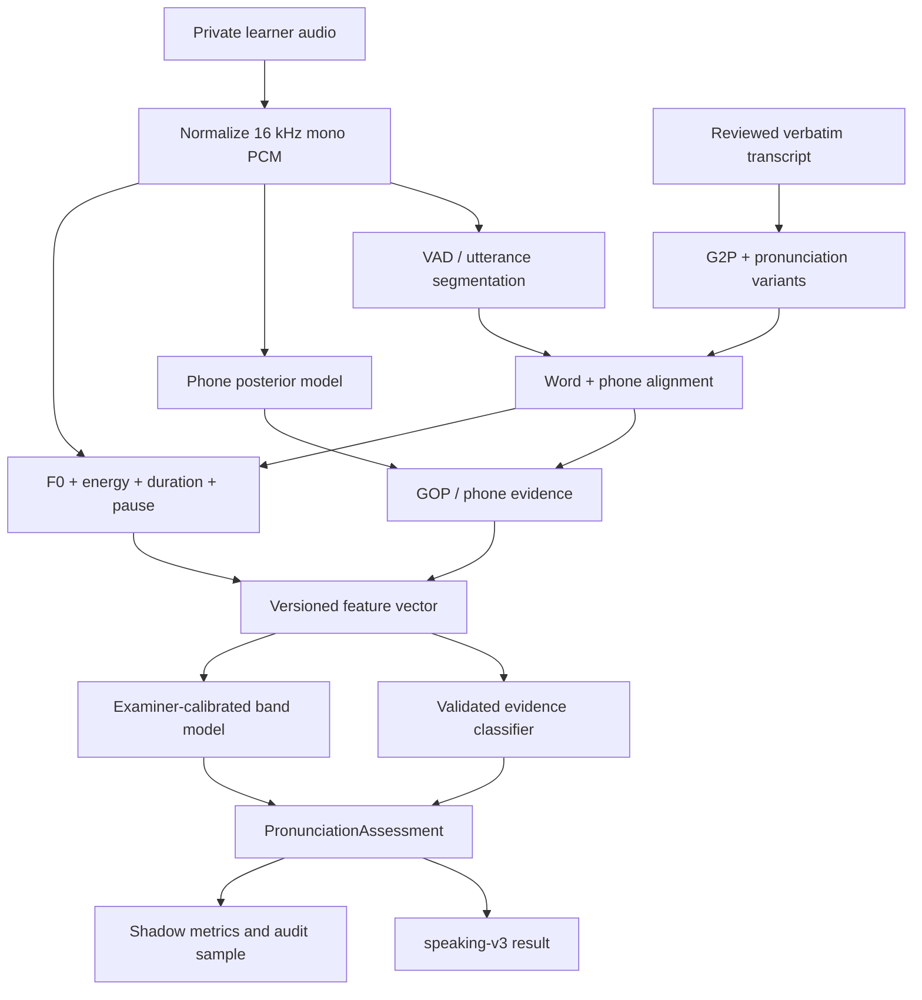

# Kế hoạch xây dựng Learn4 Pronunciation Engine

Ngày lập: 2026-10-21  
Trạng thái: kế hoạch triển khai và nghiệm thu  
Phạm vi: IELTS Speaking Pronunciation, evidence âm thanh, calibration và tích hợp `speaking-v3`

## 1. Kết quả cần đạt

Xây một pronunciation engine do Learn4 sở hữu, chạy trực tiếp trên audio và có thể:

1. Phân biệt **ASR uncertainty** với **pronunciation evidence**.
2. Căn chỉnh transcript với word, syllable và phoneme trong audio.
3. Phát hiện có kiểm soát substitution, deletion, insertion và vấn đề âm cuối.
4. Đo các đặc trưng hỗ trợ intelligibility, stress, rhythm, intonation và connected speech.
5. Trả feedback có `audio span`, evidence type và mức chắc chắn.
6. Chỉ trả Pronunciation band sau khi model được calibration bằng ratings ẩn của examiner.
7. Chỉ tính Overall IELTS diagnostic khi đủ bốn criterion band hợp lệ.

Engine là công cụ luyện tập chẩn đoán. Nó không được mô tả là điểm IELTS chính thức hoặc
examiner-equivalent nếu chưa có báo cáo validation độc lập.

## 2. Hiện trạng đã kiểm tra

Nhánh `main` tại baseline `0c27c9a` có hai implementation mâu thuẫn:

- `pronunciation/service.py::assess_pronunciation` trả `band=None`, `phoneme_evidence=[]` và ghi
  rõ chưa có model pronunciation đã validation.
- `assessment/engine.py::grade_speaking` bỏ kết quả đó, quy đổi `asr_confidence` thành band và
  dùng band 6.0 khi confidence không dùng được.
- `grade_mock_session` có thể mặc định Pronunciation 6.5 nếu không lấy được turn band.
- `assessment/scoring.py::pronun_conf_to_band` ánh xạ confidence 0.483–0.85 thành band 3–9;
  confidence trên 0.85 thành 0, rồi engine lại thay bằng 6.0.
- `ScoreGrid.jsx` tự tính một điểm từ ba criterion ngôn ngữ khi server không có `overall`.
- `CALIBRATION_VERSION` đang là `uncalibrated`; repository không có corpus examiner-rated thật.

Backend baseline: `165 passed`. Test hiện có chưa kiểm tra nhánh real-provider không được phép
suy Pronunciation band từ ASR confidence.

## 3. Nguyên tắc bất biến

### 3.1 Evidence hierarchy

| Tầng | Dữ liệu | Được kết luận |
| --- | --- | --- |
| E0 | Transcript text | Từ hệ thống nhận dạng; không kết luận phát âm |
| E1 | ASR confidence/disagreement | Vùng cần nghe lại; không phải lỗi âm vị hoặc band |
| E2 | Word/phone alignment | Vị trí evidence; alignment riêng nó chưa phải điểm |
| E3 | Phone posterior/GOP và prosody features | Candidate pronunciation observation |
| E4 | Candidate vượt threshold đã validation | Lỗi/giới hạn pronunciation có timestamp |
| E5 | Session features + examiner-calibrated model | Pronunciation band chẩn đoán |

Một tầng chỉ được dùng cho kết luận thuộc tầng đó hoặc thấp hơn. Không nâng E1/E2 thành E4/E5.

### 3.2 Raw evidence trước coaching

- Giữ audio gốc, transcript đã chọn, learner correction và pronunciation inference là các nguồn riêng.
- Tên riêng/OOV có pronunciation variants; không ép canonical phone sequence duy nhất.
- Accent không phải lỗi. Chỉ đánh dấu khi evidence cho thấy intelligibility hoặc phonological feature
  liên quan bị ảnh hưởng.
- Feedback từng âm dùng evidence E4. Coaching tổng quát từ E3 phải được gắn nhãn `observation`.
- Nếu evidence thiếu hoặc mâu thuẫn, trả `insufficient_evidence` hoặc `needs_review`.

### 3.3 Band eligibility

Pronunciation band chỉ hợp lệ khi đồng thời có:

- `pronunciation_model_version` được khai báo;
- `pronunciation_calibration_version` khác `uncalibrated`;
- artifact có schema/version/checksum hợp lệ;
- input vượt minimum duration/coverage/quality đã ghi trong artifact;
- model và artifact đã vượt release gate trên frozen speaker-disjoint test set.

Nếu thiếu một điều kiện, `band=null`, `score=null`, `status!=scored`. Overall cũng phải `null`.

## 4. Kiến trúc đích



### 4.1 Module seams

```text
backend/app/modules/speaking/pronunciation/
  contracts.py          # Typed domain result and invariants
  engine.py             # Orchestration; small public interface
  audio_features.py     # PCM, energy, F0, duration, pause features
  lexicon.py            # Dictionary/G2P/variants/OOV policy
  alignment.py          # Alignment interface + adapters
  phone_model.py        # Phone posterior interface + adapter
  gop.py                # Deterministic phone/word evidence calculations
  prosody.py            # Stress, rhythm, intonation features
  feature_vector.py     # Stable versioned model input
  calibration.py        # Load/validate inference artifacts
  policy.py             # Evidence/eligibility/abstention policy
  service.py            # Compatibility facade during migration
```

Public interface đề xuất:

```python
class PronunciationEngine(Protocol):
    def assess(self, request: PronunciationRequest) -> PronunciationAssessment: ...
```

`PronunciationRequest` chỉ chứa reference tới audio private, reviewed verbatim transcript,
word timings, ASR uncertainty và task/session metadata. Provider-specific payload không vượt seam.

## 5. Output contract

Mở rộng additive `speaking-v3`; không xóa alias hiện có trong đợt này.

```json
{
  "status": "insufficient_evidence",
  "band": null,
  "score": null,
  "band_source": "unavailable_uncalibrated_pronunciation_model",
  "evidence_quality": "medium",
  "feedback": "Có hai đoạn cần nghe lại; chưa đủ căn cứ để kết luận band phát âm.",
  "next_action_vi": "Nghe lại và đọc lại cả cụm có âm cuối /s/.",
  "phoneme_evidence": [
    {
      "id": "pe_01",
      "word_id": "w12",
      "word": "works",
      "start": 8.42,
      "end": 8.91,
      "expected_phone": "S",
      "observed_phone": null,
      "kind": "possible_deletion",
      "status": "candidate",
      "score_unscaled": -1.82,
      "confidence": null,
      "model_version": "phone-model-v1",
      "explanation_vi": "Âm cuối /s/ cần được nghe lại.",
      "practice_hint_vi": "Giữ luồng hơi ở cuối từ, sau đó đọc lại cả cụm."
    }
  ],
  "subscores": {
    "segmental_accuracy": null,
    "intelligibility": null,
    "word_stress": null,
    "rhythm": null,
    "intonation": null,
    "connected_speech": null
  },
  "provenance": {
    "engine_version": "pronunciation-engine-v1",
    "feature_version": "pronunciation-features-v1",
    "alignment_provider": "mfa",
    "alignment_model": "...",
    "phone_model": "...",
    "calibration_version": "uncalibrated"
  }
}
```

Quy tắc contract:

- `status=scored` khi và chỉ khi `band` là half-band 0–9 và calibration hợp lệ.
- `confidence` chỉ mang nghĩa probability nếu đã calibration và artifact khai báo metric/calibrator.
- `candidate` không được hiển thị như “bạn phát âm sai”. UI dùng “cần nghe lại”.
- `confirmed` trong hệ thống tự động nghĩa là vượt policy đã validation, không nghĩa human-confirmed.
  Human review dùng trường/audit event riêng.
- `start/end` phải nằm trong duration audio và `end > start`.
- Mọi evidence tham chiếu word/phone tồn tại và model version thực tế.

## 6. Kế hoạch triển khai

### P0 — Sửa false scoring và khóa regression

Thực hiện trước mọi dependency/model mới.

1. Viết test tái hiện real-provider result có `asr_confidence` cao nhưng không có calibrated
   pronunciation artifact.
2. Xóa đường `asr_confidence → pronun_conf_to_band → band` khỏi `grade_speaking`.
3. Xóa default Pronunciation 6.0 và Mock Pronunciation 6.5.
4. Dùng nguyên kết quả nullable của pronunciation module; preserve observations/features.
5. Overall chỉ được tính khi cả bốn criterion có `status=scored` và band hợp lệ.
6. `ScoreGrid` không tự gọi trung bình ba criterion là overall. Nếu cần, hiển thị riêng
   “Trung bình 3 tiêu chí ngôn ngữ”, không dùng nhãn Overall IELTS.
7. `AssessmentQualityCard` báo `language_criteria_only` khi Pronunciation chưa đủ evidence.
8. Legacy result có source `asr_confidence`, `llm_only_pending_alignment` hoặc source không rõ
   phải được adapter chuyển Pronunciation về null; không sửa JSON lịch sử tại chỗ.

Hoàn tất khi:

- Test real-provider chứng minh confidence 0.1/0.5/0.9 không tạo Pronunciation band.
- Practice và Mock không có calibrated artifact đều trả `partial`, `overall=null`.
- UI không hiển thị bốn số hoặc Overall IELTS giả.
- Backend full tests, frontend lint/build và relevant Playwright pass.

### P1 — Domain contract và engine facade

1. Tạo typed models cho request, audio quality, alignment, phone evidence, prosody evidence,
   subscores, provenance và final assessment.
2. Validators thực thi invariants tại mục 5.
3. Tạo `PronunciationEngine` và `DisabledPronunciationEngine` trả nullable result đúng contract.
4. `service.py` trở thành compatibility facade gọi engine; không giữ hai implementation scoring.
5. Inject dependencies; test dùng fake aligner/phone model, không tải model hoặc gọi mạng.
6. Thêm config explicit: mode `disabled|shadow|enabled`, artifact paths, model versions,
   timeouts và evidence thresholds. Default production là `disabled` cho tới release gate.

Hoàn tất khi mọi caller đi qua một interface, invalid evidence bị Pydantic/domain validation từ chối,
và disabled mode bảo toàn feedback quan sát nhưng không trả band.

### P2 — Audio, lexicon và alignment

1. Tái sử dụng audio processor để tạo private temporary mono PCM 16 kHz; cleanup bằng `finally`.
2. Tách utterance bằng VAD/segment hiện có; giữ mapping timestamp về audio gốc.
3. Xây lexicon adapter:
   - CMUdict hoặc dictionary có license phù hợp;
   - G2P cho OOV;
   - nhiều pronunciation variants;
   - names/proper nouns có trạng thái unresolved thay vì đoán chắc;
   - stress marks ở syllable/phone khi nguồn có hỗ trợ.
4. Hoàn thiện MFA adapter theo version CLI thực sự được pin. Parse output thành contract thống nhất.
5. WhisperX chỉ được dùng cho word/character timing; không khai báo phone evidence khi adapter
   không cung cấp phoneme alignment.
6. Tính alignment coverage, OOV ratio, phone duration sanity và failure reason.

Hoàn tất khi fixture audio có transcript tạo alignment deterministically, timestamp nằm trong audio,
OOV/variant/failure có test, và alignment failure dẫn tới abstention thay vì band mặc định.

### P3 — Phone posterior và GOP evidence

1. Benchmark ít nhất hai model open-weight có model card/license rõ, hỗ trợ English phone posterior
   và chạy được trong target container. Không chọn chỉ vì ASR WER tốt.
2. Pin model ID, revision, phone inventory, sample rate, checksum và license trong artifact manifest.
3. Chuẩn hóa phone set giữa lexicon/alignment/model; mapping mất thông tin phải được ghi và test.
4. Với mỗi aligned phone, tính:
   - target posterior/log likelihood theo frame;
   - strongest competing phone;
   - GOP hoặc log-likelihood ratio;
   - duration/coverage;
   - optional-phone/variant handling.
5. Tổng hợp theo word nhưng giữ raw phone evidence. Không hardcode threshold thành probability.
6. Trước calibration, output `score_unscaled` và `status=candidate`; không xuất lỗi chắc chắn/band.
7. Test substitution/deletion/insertion bằng fixture hoặc frozen model outputs; unit test không tải model.

Hoàn tất khi cùng frozen input sinh cùng feature vector/version, phone mapping đầy đủ, và không có
candidate nào thiếu audio span, word reference hoặc provenance.

### P4 — Prosody, stress, rhythm và intonation

1. Tạo feature extractor versioned trên PCM:
   - voiced/unvoiced và F0 contour;
   - energy contour;
   - phone/syllable/word duration;
   - pause count, duration và location;
   - articulation/speech rate dùng đúng scope;
   - pitch range/slope/terminal movement;
   - lexical stress contrast khi dictionary có stress target;
   - phrase stress, rhythm và connected-speech observations.
2. Normalize theo speaker/utterance phù hợp; không dùng ngưỡng pitch tuyệt đối chung cho mọi giọng.
3. Không gọi word-duration dispersion là stress evidence.
4. Tách Fluency pause features khỏi Pronunciation prosody; một feature có thể được dùng bởi hai
   criterion nhưng interpretation và model phải riêng.
5. Thiết lập quality gates cho clipping, SNR proxy, voiced coverage và minimum speech duration.

Hoàn tất khi features ổn định trên fixtures, silence/noise/clipping không tạo pronunciation lỗi,
và thiếu F0/stress target dẫn đến missing feature thay vì giá trị 0 mang nghĩa kém.

### P5 — Dataset và offline training/evaluation tooling

Tạo `backend/scripts/pronunciation/` với schema, validation, feature extraction, train, evaluate
và artifact export. Không commit raw learner audio hoặc downloaded public corpora.

#### Dataset khởi tạo

- SpeechOcean762 dùng để bootstrap sentence/word/phoneme assessment.
- L2-ARCTIC dùng cho substitution/deletion/addition và slice Vietnamese L1.
- Không map score public corpus thẳng thành IELTS band.
- Kiểm tra license và ghi provenance trước download/use.

#### Dataset Learn4 mục tiêu

- 300–500 full IELTS Speaking sessions từ ít nhất 150 người nói độc lập.
- Có Part 1/2/3, thiết bị, vùng giọng, noise và band range đa dạng.
- Hai examiner đủ năng lực chấm độc lập, không thấy prediction; bất đồng >1 band có adjudication.
- Stratified subset 20–30% được annotator ngữ âm đánh dấu phone/word errors và audio spans.
- Consent cho training/evaluation, retention và quyền xóa được ghi rõ.
- Split 70/15/15 theo speaker trước khi segment; session của một speaker không qua split khác.
- Frozen test không được dùng chọn feature, threshold, model hoặc calibrator.

#### Artifact

Artifact phải có schema, feature version, model class, weights/checksum, training dataset IDs,
speaker/sample counts, slice coverage, calibration method, thresholds, metrics, creation commit và
compatibility range. Loader fail closed khi thiếu hoặc mismatch.

Hoàn tất khi scripts từ manifest hợp lệ có thể tái tạo features/model/report, validator bắt leakage,
expired consent, duplicate audio và examiner-label violation, còn tests dùng synthetic metadata.

### P6 — Calibration và release gates

Hai bài toán riêng:

1. **Evidence classifier:** candidate phone/word nào đủ căn cứ để hiển thị như limitation/error.
2. **Band model:** session-level features thành half-band Pronunciation.

Baseline model nên đơn giản và giải thích được: regularized/ordinal regression hoặc gradient boosting
trên frozen features. Chỉ dùng deep end-to-end model khi baseline và dữ liệu chứng minh cần thiết.

Metric bắt buộc:

- Phone/word: precision, recall, F1; confusion theo phone và L1; timestamp overlap.
- Claim quality: human-confirmed precision, unsupported claim rate, abstention/coverage.
- Band: MAE, QWK, bias, within ±0.5, coverage và 95% speaker-bootstrap CI.
- Slice: Vietnamese region/accent, gender/voice range, device, noise, Part và band range.
- Runtime: RTF, P50/P95 latency, peak RAM/CPU và failure rate.

Release gate đề xuất, vẫn là TBR đến khi pilot được review:

- Unsupported pronunciation claim ≤ 2% trên human-audited test claims.
- Displayed error precision ≥ 90%; coverage được báo, không tối ưu precision bằng cách ẩn hết.
- Pronunciation MAE ≤ 0.5, QWK ≥ 0.75, within ±0.5 ≥ 80%.
- Không slice chính nào có absolute mean bias > 0.5 band.
- ≥ 95% eligible sessions có terminal assessment; mọi abstention có reason.
- Không regression security/privacy và không raw content trong metric logs.

Chỉ khi toàn bộ gate được thỏa, đổi mode từ `shadow` sang `enabled` bằng config/feature flag.

### P7 — Product integration và UX evidence

1. `PronunErrorList` nhận typed evidence, không dùng `heard/intended` từ ASR như lỗi pronunciation.
2. Mỗi evidence card có word, IPA/phone nếu hợp lệ, status, giải thích, hint và nút replay đoạn audio.
3. `candidate` dùng nhãn “Cần nghe lại”; validated limitation mới dùng “Điểm cần cải thiện”.
4. Red token luôn có correction/evidence tương ứng; màu không là tín hiệu duy nhất.
5. ScoreGrid phân biệt:
   - bốn criterion band khi đủ điều kiện;
   - ba language criteria và Pronunciation pending;
   - Overall chỉ từ server.
6. Teacher review có thể confirm/dismiss evidence; event được lưu riêng để audit/retraining.
7. Learner transcript correction không tự đổi pronunciation evidence hoặc examiner labels.

Hoàn tất khi keyboard/a11y/replay/mobile tests pass và UI không biến ASR uncertainty thành lỗi âm.

### P8 — Runtime, shadow rollout và vận hành

1. Pronunciation inference chạy trong worker/container hỗ trợ native audio/model dependencies,
   không chạy trong Cloudflare Worker hoặc Vercel Function giới hạn hiện tại.
2. Tách dependency production thành remote-only API image và pronunciation worker image/profile.
3. Model được preload trong worker, có concurrency cap, timeout và memory/CPU metrics.
4. Audio lấy từ private object storage vào temporary path, xóa sau attempt.
5. Shadow mode tính result nhưng không hiển thị band; sampling audit theo consent.
6. So sánh shadow với examiner/human review, theo dõi drift theo model/provider/device.
7. Canary bằng feature flag; rollback chỉ cần config, không migration phá dữ liệu.
8. Không deploy commercial trên free host không có SLA hoặc điều khoản production phù hợp.

Hoàn tất khi cold/warm benchmark, crash/retry, duplicate task, artifact missing/corrupt, provider outage
và rollback đều có kết quả ghi trong verification report.

## 7. File impact dự kiến

### Backend hiện có cần sửa

- `backend/app/modules/speaking/assessment/engine.py`
- `backend/app/modules/speaking/assessment/scoring.py`
- `backend/app/modules/speaking/assessment/quality.py`
- `backend/app/modules/speaking/schemas.py`
- `backend/app/modules/speaking/pronunciation/service.py`
- `backend/app/modules/speaking/pronunciation/alignment.py`
- `backend/app/core/config.py`
- `backend/app/modules/speaking/jobs.py` khi worker profile được tách
- `backend/requirements*.txt` và container definition phù hợp

### Frontend hiện có cần sửa

- `frontend/src/features/speaking/components/ScoreGrid.jsx`
- `frontend/src/features/speaking/components/PronunErrorList.jsx`
- `frontend/src/features/speaking/components/AssessmentQualityCard.jsx`
- `frontend/src/features/speaking/pages/SpeakingPractice.jsx`
- `frontend/src/features/speaking/pages/SpeakingMockTest.jsx`
- controller/result adapters liên quan

### File mới dự kiến

- Các module mục 4.1 khi có implementation thật.
- `backend/scripts/pronunciation/`.
- `backend/tests/test_pronunciation_contract.py`.
- `backend/tests/test_pronunciation_engine.py`.
- `backend/tests/test_pronunciation_artifact.py`.
- `backend/tests/test_pronunciation_dataset.py`.
- Frontend/Playwright tests cho nullable/scored/evidence/replay.
- `docs/verification/pronunciation-engine-report.md`.

Không tạo file/module rỗng chỉ để khớp cây. Mỗi module mới phải có responsibility thật và test qua
public interface.

## 8. Test strategy

### Unit/contract

- Status-band invariant, timestamp bounds, word/phone reference, artifact compatibility.
- Confidence semantics: uncalibrated score không được xuất như probability.
- Phone mapping, variants, optional phone, OOV, silence, clipping và missing F0.
- GOP với frozen posterior arrays; không cần model/network.
- Feature versioning và deterministic serialization.
- Overall eligibility và legacy adapter.

### Integration

- One short licensed/generated speech fixture đi qua PCM → alignment → features → nullable result.
- Artifact loader với valid/missing/corrupt/wrong-version/checksum.
- Job retry/crash/duplicate với private object reference.
- Model adapter test được đánh dấu riêng; cache/model fixture explicit, không download âm thầm.

### UI/E2E

- Pronunciation unavailable: ba language bands, Pronunciation pending, overall absent.
- Candidate evidence: “Cần nghe lại”, replay đúng bounded segment.
- Scored fixture: bốn bands + overall từ server + provenance.
- Mobile, keyboard, no-color-only status và error recovery.

### Accuracy/offline

- Speaker-disjoint frozen datasets.
- Bootstrap CI theo speaker.
- So sánh baseline/current/candidate trên cùng manifest.
- Report failures và abstentions trong denominator.

## 9. Commands kiểm chứng tối thiểu

```bash
cd backend
./.venv/bin/python -m pytest -q
./.venv/bin/ruff check app tests scripts

cd ../frontend
npm ci
npm run lint
npm run build
npx playwright test
```

Model integration/accuracy commands phải được thêm vào README của `scripts/pronunciation` và dùng
artifact/cache explicit. Unit test mặc định phải chạy offline.

## 10. Điều kiện dừng và những việc AI không thể tự hoàn tất

AI coding có thể hoàn tất P0–P5 tooling, contract, adapters, features, tests, UI và shadow wiring.
AI không được tự tuyên bố P6/P8 hoàn tất nếu thiếu:

- audio có consent/license;
- examiner ratings độc lập;
- phone annotations đủ chất lượng;
- frozen train/validation/test;
- benchmark trên target infrastructure;
- Product/Assessment sign-off cho release gates.

Thiếu dữ liệu không phải lý do để thay band bằng heuristic. Kết quả đúng là giữ `band=null`, hoàn
thành code/tooling không phụ thuộc dữ liệu, và ghi chính xác phần bị chặn trong verification report.

## 11. Tài liệu nguồn

- [Architectural drivers](../architecture/architecture-drivers.md)
- [Current system map](../architecture/current-system.md)
- [IELTS Speaking ASR research](../research/ielts-speaking-asr-primary-sources.md)
- [Deepgram/ElevenLabs evaluation](../research/deepgram-elevenlabs-ielts-speaking-evaluation.md)
- [IELTS Speaking Band Descriptors](https://ielts.org/cdn/ielts-guides/ielts-speaking-band-descriptors.pdf)
- [Montreal Forced Aligner documentation](https://montreal-forced-aligner.readthedocs.io/)
- [SpeechOcean762 paper](https://arxiv.org/abs/2104.01378)
- [L2-ARCTIC corpus](https://psi.engr.tamu.edu/l2-arctic-corpus/)

