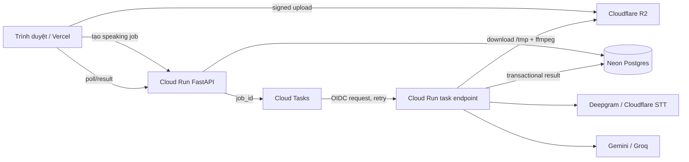

# Hạ tầng backend chi phí 0 USD cho Learn4 Speaking

Ngày kiểm tra: 21/10/2026. Phạm vi chỉ gồm tài liệu chính thức công khai tại ngày kiểm tra. “0 USD” trong báo cáo nghĩa là có thể vận hành trong quota miễn phí; đây không phải cam kết không bao giờ bị tính phí. Deepgram, Gemini, Groq và các API AI có quota/điều khoản riêng, không nằm trong chi phí hosting dưới đây.

## Kết luận để ra quyết định

Phương án tốt nhất cho bản beta có người dùng thật là:

1. **Google Cloud Run** chạy FastAPI theo request, `min-instances=0`, `max-instances=1`, request-based billing.
2. **Google Cloud Tasks** thay thread polling hiện tại: API ghi job vào Postgres, enqueue `job_id`; một endpoint Cloud Run riêng xử lý trọn job trong request Cloud Tasks và ghi kết quả idempotent.
3. **Neon Free Postgres** qua pooled connection cho dữ liệu ứng dụng và trạng thái job.
4. **Cloudflare R2 Standard** cho audio; trình duyệt upload trực tiếp bằng signed URL, worker tải audio vào `/tmp`, xử lý rồi xóa. Thiết lập lifecycle theo thời hạn lưu trữ.
5. Giữ frontend trên Vercel khi thử nghiệm; **phải đổi khỏi Vercel Hobby hoặc nâng Pro trước khi bán**, vì [Vercel Hobby chỉ cho mục đích cá nhân, phi thương mại](https://vercel.com/docs/plans/hobby#commercial-usage).

Cloud Run có free tier đủ rộng cho beta tải thấp: [2 triệu request, 180.000 vCPU-second và 360.000 GiB-second mỗi tháng](https://docs.cloud.google.com/free/docs/free-cloud-features#cloud-run), nhưng **bắt buộc billing account/phương thức thanh toán** và có thể phát sinh phí vượt quota. [Cloud Tasks có 1 triệu operation/tháng miễn phí](https://cloud.google.com/tasks/pricing). Neon Free không yêu cầu thẻ theo [trang giá chính thức](https://neon.com/pricing); R2 cần hoàn tất subscription checkout và [phương thức thanh toán](https://developers.cloudflare.com/billing/get-started/create-billing-profile/).

Phương án dự phòng không cần thẻ cho compute là **Render Free Web + Neon Free Postgres + Neon Object Storage**. Nó chỉ phù hợp preview/beta nhỏ: Render ghi rõ free instance không dùng cho production, có 0,1 CPU/512 MB, ngủ sau 15 phút và mất khoảng một phút để thức dậy. Không có free background worker, nên vẫn phải đổi job thành request callback/webhook. Neon Object Storage hiện [S3-compatible và Free có 5 GB/project](https://neon.com/blog/neon-free-plan-1-gb-per-project), có thể thay R2 để tránh yêu cầu thẻ; cần đổi endpoint/credential và benchmark SDK trước khi cutover.

Không có lựa chọn 0 USD nào trong danh sách cung cấp đồng thời SLA production, worker luôn chạy, Postgres bền vững, object storage và quyền thương mại rõ ràng. Khi bắt đầu thu tiền, hạ tầng phải có ngân sách tối thiểu và monitoring; free tier nên được xem là giai đoạn beta.

## Vì sao container hiện tại không thể deploy nguyên trạng

- [`backend/Dockerfile`](../../backend/Dockerfile) là container Python 3.12 hợp lệ và cài `ffmpeg`, phù hợp Cloud Run/Render/Koyeb/Railway/Northflank.
- [`backend/requirements.txt`](../../backend/requirements.txt) vẫn cài `faster-whisper`; image và cold start sẽ nặng dù production dùng Deepgram/Cloudflare. Nên có remote-only image bỏ local Whisper sau khi xác nhận không còn fallback cục bộ.
- [`jobs.py`](../../backend/app/modules/speaking/jobs.py) dùng daemon thread polling và giữ `audio_path` cục bộ. Cloud Run request-based chỉ cấp CPU khi request đang chạy và instance có thể bị hủy khi idle; Render/Koyeb cũng sleep. Job có thể mắc ở `pending/processing`, còn file biến mất.
- [`audio/processor.py`](../../backend/app/integrations/audio/processor.py) gọi subprocess `ffmpeg`; điều này cần Linux container và filesystem tạm. Cloudflare Python Workers/Vercel Functions không phải runtime thay thế tương đương.
- [`blob.py`](../../backend/app/integrations/storage/blob.py) đã dùng `boto3` với S3-compatible endpoint, nên R2 hoặc Neon Object Storage là thay đổi nhỏ hơn Supabase Storage.
- Cấu hình cho phép audio tới 25 MB/600 giây. Upload thẳng vào object storage tránh giới hạn body của Vercel và giảm thời gian request API.

## Kiến trúc đề xuất

Cloud Run request timeout mặc định 5 phút và [tối đa 60 phút](https://docs.cloud.google.com/run/docs/configuring/request-timeout); HTTP target task có [deadline tối đa 30 phút](https://docs.cloud.google.com/tasks/docs/creating-http-target-tasks). Một lượt speaking 10 phút audio phải hoàn tất dưới 30 phút hoặc chia pipeline. Task payload chỉ chứa `job_id`, không chứa audio. Endpoint phải claim job bằng transaction, chống xử lý trùng, giới hạn attempts và coi retry là bình thường.

Cloud Run filesystem là [in-memory/ephemeral](https://docs.cloud.google.com/run/docs/container-contract#file_system); chỉ dùng `/tmp` trong request. Với request-based billing, [CPU chỉ được cấp trong lúc xử lý request, startup và shutdown](https://docs.cloud.google.com/run/docs/configuring/billing-settings). `min-instances=0` không có idle instance charge, còn giữ warm instance sẽ phát sinh phí theo [minimum instances pricing](https://docs.cloud.google.com/run/docs/configuring/min-instances).

Để tối đa khả năng giữ 0 USD, chọn một vùng Tier 1 như `us-central1`, bật budget alert, đặt `max-instances=1`, theo dõi CPU/GiB-second và egress. Budget alert không phải hard cap. Free outbound của Google Cloud chỉ 1 GiB/tháng từ Bắc Mỹ trong [Free Program](https://docs.cloud.google.com/free/docs/free-cloud-features); audio gửi từ Cloud Run sang STT có thể vượt ngưỡng. Upload thẳng R2 và nén audio giúp giảm lưu lượng, nhưng cần theo dõi thực tế.

Neon Free hiện có 100 CU-hour/project/tháng, 1 GB Postgres/project, scale tối đa 2 CU/~8 GB RAM, và scale-to-zero sau 5 phút; xem [Free plan](https://neon.com/docs/introduction/plans) và [compute settings](https://neon.com/docs/manage/endpoints/). Dùng pooled URL, `pool_pre_ping`, retry kết nối khi database vừa thức dậy. Free plan không có SLA và chỉ có restore window ngắn, nên cần export backup định kỳ ngoài Neon trước khi bán.

R2 Standard có [10 GB-month, 1 triệu Class A, 10 triệu Class B và egress miễn phí](https://developers.cloudflare.com/r2/pricing/). Không dùng Infrequent Access vì free tier không áp dụng. R2 là usage-based subscription; Cloudflare có thể pre-authorize thẻ và tính phí vượt quota theo [billing policy](https://developers.cloudflare.com/billing/understand/billing-policy/).

## Ma trận so sánh

| Nền tảng | Free tier thật sự / card | Sleep, tài nguyên, timeout | Persistence và job nền | Quyền thương mại / kết luận |
| --- | --- | --- | --- | --- |
| **Google Cloud Run** | Có; billing account và xác minh payment bắt buộc. Free: 2M request, 180k vCPU-s, 360k GiB-s/tháng. | Scale-to-zero; cold start phụ thuộc image. Default 512 MiB; request tối đa 60 phút. | Filesystem ephemeral. Daemon không đáng tin ở request-based; Cloud Tasks giải quyết với 1M ops free. | Không thấy cấm thương mại trong tài liệu đã xem; không SLA ở free usage và có rủi ro overage. **Chọn primary.** |
| **Hugging Face Spaces** | Docker/Gradio Space mới yêu cầu PRO/Team/Enterprise dù CPU Basic ghi $0/giờ; PRO $9/tháng theo [pricing](https://huggingface.co/pricing). | CPU Basic 2 vCPU/16 GB/50 GB non-persistent; free hardware sleep khi idle theo [Spaces overview](https://huggingface.co/docs/hub/en/spaces-overview). | Storage persistent không nằm trong lựa chọn 0 USD; không phù hợp queue production. | Không còn là hosting Docker 0 USD cho account mới. **Loại.** |
| **Render** | Có, không cần payment để deploy free theo [first deploy](https://render.com/docs/your-first-deploy); nếu thêm card có thể bị tính bandwidth/build overage. | [0,1 CPU/512 MB](https://render.com/docs/compute-plans), sleep sau 15 phút, wake khoảng 1 phút, 750 instance-hours/workspace/tháng. | FS ephemeral; không free disk/background worker; Free Postgres 1 GB hết hạn sau 30 ngày. | Render ghi rõ [free không dùng production](https://render.com/docs/free). **Fallback preview**, không phải commercial production. |
| **Koyeb** | Một Free Web Service; card bắt buộc và có temporary preauthorization $29 theo [pricing FAQ](https://www.koyeb.com/docs/faqs/pricing). | 0,1 vCPU/512 MB/2 GB SSD; sleep sau 1 giờ, cold 1–5 giây; edge request timeout [100 giây](https://www.koyeb.com/docs/reference/edge-network). | Free không hỗ trợ Worker/Volume/custom scaling theo [instance docs](https://www.koyeb.com/docs/reference/instances). | Koyeb nói free chỉ hobby/testing, không production. **Loại.** |
| **Fly.io** | Chỉ trial; account mới phải có card và không có recurring free allowance theo [pricing](https://fly.io/docs/about/pricing/). | Usage-based Machines. | Có volume/VM nhưng đều tính phí. | Không phải zero-cost. **Loại.** |
| **Railway** | Free $0, $1 credit/tháng sau trial; trial không cần card. | 1 vCPU/0,5 GB, 1 GB ephemeral, 0,5 GB volume, 1 replica theo [plan docs](https://docs.railway.com/pricing/plans). RAM $10/GB-month và CPU $20/vCPU-month; $1 không đủ always-on. | Docker/volume chạy được nhưng workload dừng khi credit hết; free data retention hạn chế. | Railway gọi Free là experimentation, Pro mới cho production. **Chỉ demo có traffic rất thấp.** |
| **Northflank** | Sandbox: 2 service, 1 DB, 2 cron, always-on; mọi user phải thêm payment method theo [billing docs](https://northflank.com/docs/v1/application/billing/pricing-on-northflank). | Không sleep; free resource size cụ thể không được cam kết rõ trên trang plan đã xem. | Có service/job/database, gần với app hiện tại nhất. | Chính Northflank nói Sandbox không dùng production, không SLA. **Chỉ dùng dev/staging.** |
| **Zeabur** | Free không cần card, nhưng [pricing hiện tại](https://zeabur.com/en-US/pricing) chỉ cho quản lý một server tự sở hữu; không kèm runtime hosted. | Runtime phụ thuộc server người dùng; free dashboard không giải quyết compute. | Khi downgrade Free, containerized services bị suspend theo [subscription docs](https://zeabur.com/docs/en-US/subscription). | Không phải lựa chọn hosted backend 0 USD hiện tại. **Loại.** |
| **PythonAnywhere** | Beginner $0, không cần card. | 1 web worker, 512 MB file, bandwidth thấp; không Docker/SSH. | Không scheduled/always-on task, không MySQL; outbound Internet chỉ allowlist theo [pricing](https://www.pythonanywhere.com/pricing/). | Không gọi tùy ý Deepgram/Gemini/Groq và không chạy container/ffmpeg worker. **Loại.** |
| **Vercel Python** | Hobby $0, không cần card. | Python/FastAPI runtime vẫn beta; 2 GB/1 vCPU, response/body 4,5 MB, `/tmp` 500 MB, function tối đa [300 giây](https://vercel.com/docs/functions/limitations). | Không daemon bền vững, filesystem tạm; audio 25 MB vượt body limit. | Hobby **cấm commercial**. **Loại cho backend và phải xử lý frontend trước khi bán.** |
| **Cloudflare Python Workers** | Workers Free không cần paid plan; R2 cần subscription/payment method. | [100k request/ngày, 10 ms CPU/request, 128 MB RAM](https://developers.cloudflare.com/workers/platform/limits/). Python chạy Pyodide. | Thread/process không hoạt động và filesystem in-memory ephemeral theo [Python stdlib limits](https://developers.cloudflare.com/workers/languages/python/stdlib/); `waitUntil` chỉ kéo dài tối đa 30 giây sau response. | FastAPI syntax được hỗ trợ, nhưng không chạy `ffmpeg`, SQLAlchemy/psycopg và worker hiện tại. Chỉ giữ làm STT proxy/edge. **Không phải drop-in backend.** |
| **Cloudflare D1/R2** | D1 Free: 5M rows read, 100k writes/ngày, 5 GB theo [D1 pricing](https://developers.cloudflare.com/d1/platform/pricing/); R2 quota như trên và cần payment. | Scale-to-zero. | D1 là SQLite-compatible binding, không phải Postgres/SQLAlchemy drop-in; R2 phù hợp boto3 S3. | R2 **chọn cho audio**; D1 chỉ dùng nếu chấp nhận rewrite database/runtime. |
| **Neon** | $0, không giới hạn thời gian, không cần card theo [pricing](https://neon.com/pricing). | 100 CU-hour/project; 0,25 CU tương đương khoảng 400 active hours; sleep sau 5 phút. | Postgres chuẩn, pooled connection; 1 GB DB/project. Object Storage S3-compatible 5 GB/project. | Không thấy cấm thương mại, nhưng Free được mô tả cho prototype/small team, không SLA. **Chọn DB; object storage là fallback không thẻ.** |
| **Supabase** | Free $0, 2 project; [Free không bị charge](https://supabase.com/docs/guides/platform/cost-control). Tài liệu hiện tại không tuyên bố rõ card có bắt buộc lúc signup; bài công bố Free nói không cần card. | Shared CPU/500 MB; project ít hoạt động [pause sau 7 ngày](https://supabase.com/docs/guides/platform/free-project-pausing). | 500 MB database quota, 1 GB file storage, 5 GB egress theo [billing docs](https://supabase.com/docs/guides/platform/billing-on-supabase); không automatic backup Free. | Hợp all-in-one prototype nhưng quota DB nhỏ, inactivity pause và Storage không drop-in boto3. **Fallback DB/storage thứ hai.** |

## Rủi ro vận hành và điều kiện launch

1. **Chi phí không có hard cap trên Cloud Run/R2.** Đặt quota/max instances, budget alert, dashboard theo ngày và endpoint kill switch. R2 rounding có thể tính theo nguyên triệu operation/GB nếu vượt free tier.
2. **Cold start kép.** Cloud Run và Neon cùng ngủ. Slim image bỏ `faster-whisper`, dùng pooled DB URL, health check nhẹ và retry kết nối. Không ping giữ warm vì sẽ tiêu free compute.
3. **Job trùng hoặc mất.** Cloud Tasks là at-least-once. Claim bằng conditional update/row lock, lưu attempt/provider request id, và chỉ commit kết quả một lần.
4. **Audio và quyền riêng tư.** Bucket private, signed URL ngắn hạn, server-side encryption, lifecycle deletion, không dùng public R2 URL mặc định; ghi consent và retention theo thị trường bán hàng.
5. **Quota AI độc lập.** Free hosting không làm Deepgram/ElevenLabs/Gemini/Groq miễn phí. Khi hết credit, job phải fail rõ, không loop retry tốn quota.
6. **Không SLA.** Neon Free, Cloud Run free usage và object storage free quota không tạo cam kết uptime/support. Cần backup/export, status page, retry và kế hoạch nâng paid khi có doanh thu.
7. **Quyền thương mại.** Vercel Hobby cấm commercial; Render/Koyeb/Northflank nói free dành cho hobby/test và không production. ElevenLabs Free cũng có hạn chế thương mại riêng như đã ghi trong báo cáo ASR của repo. Không launch paid product trên các plan đó.

## Trình tự migration ít rủi ro

1. Tách production dependency/image remote-only; giữ `ffmpeg`, bỏ model local và `faster-whisper` khỏi image production.
2. Chuyển upload sang signed object URL; DB chỉ lưu private object key, checksum, duration và retention deadline.
3. Thay daemon polling bằng Cloud Tasks callback có OIDC, idempotency và deadline dưới 30 phút. Retention dùng object lifecycle và scheduled request, không dùng thread.
4. Chuyển DB sang Neon pooled Postgres; chạy migration và test reconnect/scale-to-zero.
5. Deploy Cloud Run ở `min=0/max=1`, request-based billing; chạy load test CLI với audio 1, 2 và 10 phút, đo cold p95, RAM, CPU-second, egress và timeout.
6. Chỉ mở beta sau khi test crash giữa job, retry trùng, R2/Neon/API timeout và quota exhaustion. Đặt ngưỡng nâng paid dựa trên số job/ngày và p95 latency, không đợi dịch vụ bị suspend.

Kiến trúc này giữ số thay đổi thấp vì vẫn dùng Docker/FastAPI/Postgres/S3-compatible storage, đồng thời sửa đúng điểm không tương thích duy nhất có tính hệ thống: worker thread và file local. Cloudflare Workers/D1 có thể rẻ hơn về lâu dài nhưng đòi rewrite lớn và không chạy được pipeline `ffmpeg` hiện tại; đó không phải đường triển khai gấp an toàn.
