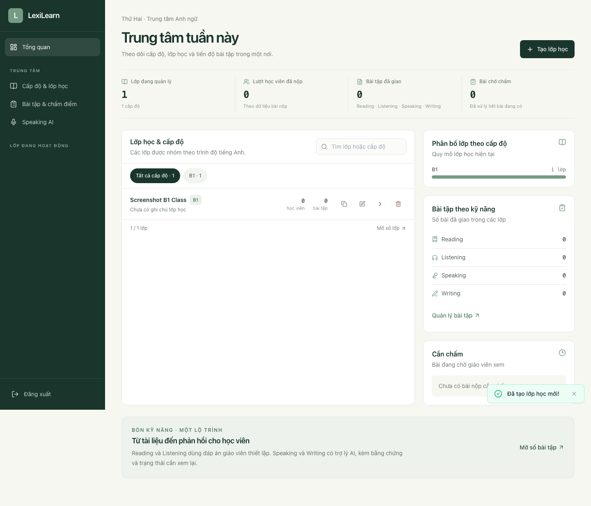
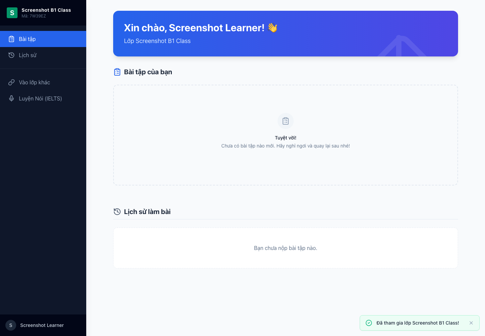
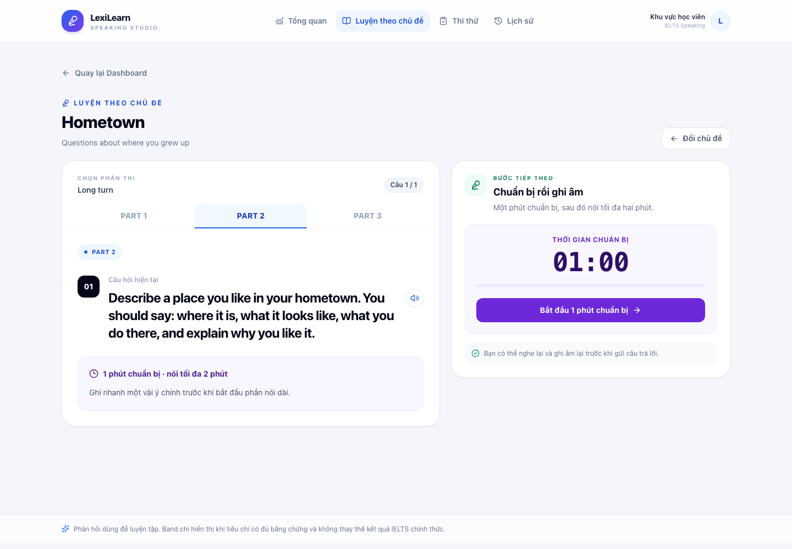
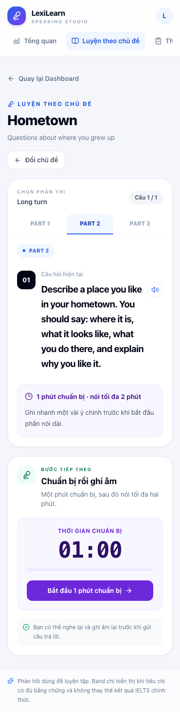

# LexiLearn refactor handoff

Completed 2026-10-18. The work follows R0–R5 in
[`docs/prompts/refactor-handoff.md`](../prompts/refactor-handoff.md). The frontend design and
interaction were not redesigned. No database schema, endpoint contract, score, secret, media file,
model cache or reference tree was intentionally altered.

## Result

- Backend and frontend are organized as a modular monolith by feature, with explicit database
  model registration, router composition and application lifecycle wiring.
- Speaking assessment orchestration is separate from LLM/STT provider transport, audio processing
  and storage adapters. Persistent Speaking jobs, retries and recovery remain in the feature.
- Frontend routes use role/context layouts; feature API clients share one transport; Practice and
  Mock state/polling live in controller hooks. The existing page markup and visual treatment were
  retained.
- The API and normalized ORM snapshots match baseline. Existing local DB/audio/curl artifacts
  remain in place. See the preserved-artifact evidence and limitation below.
- `learn4/` and `luyennoi-clone/` were left in place and marked reference-only/excluded from
  primary app tooling. No commit, push, deployment, training or real-provider call was performed.

## Final module map

| Responsibility | Final location |
|---|---|
| App entry, configuration, access, startup/readiness | `backend/app/main.py`, `core/`, `modules/registry.py` |
| Base, engine/session and model registration | `backend/app/db/` |
| Classes | `backend/app/modules/classes/` |
| Assignments and assignment use cases | `backend/app/modules/assignments/` |
| Submissions, review and objective grading | `backend/app/modules/submissions/` |
| Speaking router, Practice/Mock use cases, jobs, assessment and pronunciation | `backend/app/modules/speaking/` |
| Writing assessment | `backend/app/modules/writing/` |
| Audio, local/R2 storage, STT, LLM and OCR provider seams | `backend/app/integrations/` |
| Budget, retention and seed operations | `backend/app/operations/` |
| Route tree and entry | `frontend/src/app/`, `frontend/src/main.jsx` |
| Role/context layouts | `frontend/src/layouts/` |
| Feature pages, APIs, components and state | `frontend/src/features/` |
| Shared HTTP transport and UI | `frontend/src/shared/` |
| Global styles | `frontend/src/styles/global.css` |

The detailed live route/API map is in [`docs/architecture/current-system.md`](../architecture/current-system.md).

## File move map

### Backend

| Previous path | Final path / disposition |
|---|---|
| `backend/app/config.py` | `backend/app/core/config.py` |
| `backend/app/deps.py` | `backend/app/core/access.py` |
| `backend/app/db.py` | `backend/app/db/base.py` and `backend/app/db/session.py` |
| `backend/app/main.py` | Retained; wires `core/bootstrap.py` and `modules/registry.py` |
| `backend/app/seed.py` | `backend/app/operations/seed.py` |
| `backend/app/models/class_.py` | `backend/app/modules/classes/models.py` |
| `backend/app/models/assignment.py` | `backend/app/modules/assignments/models.py` |
| `backend/app/models/submission.py` | `backend/app/modules/submissions/models.py` |
| `backend/app/models/speaking.py` | `backend/app/modules/speaking/models.py` |
| `backend/app/models/topic.py` | `backend/app/modules/speaking/legacy_models.py` (legacy generic tables retained) |
| `backend/app/schemas/class_.py` | `backend/app/modules/classes/schemas.py` |
| `backend/app/schemas/assignment.py` | `backend/app/modules/assignments/schemas.py` |
| `backend/app/schemas/submission.py` | `backend/app/modules/submissions/schemas.py` |
| `backend/app/schemas/speaking.py` | `backend/app/modules/speaking/schemas.py` |
| `backend/app/routers/classes.py` | `backend/app/modules/classes/router.py` |
| `backend/app/routers/assignments.py` | `backend/app/modules/assignments/router.py` |
| `backend/app/routers/submissions.py` | `backend/app/modules/submissions/router.py` |
| `backend/app/routers/speaking.py` | `backend/app/modules/speaking/router.py` |
| `backend/app/services/assessment_service.py` | `backend/app/modules/speaking/assessment/engine.py`; Writing coordination moved to `backend/app/modules/writing/assessment.py` |
| `backend/app/services/llm_service.py` | LLM transport in `backend/app/integrations/llm/transport.py`; Speaking raters in `backend/app/modules/speaking/assessment/raters.py` |
| `backend/app/services/rater_contract.py` | `backend/app/modules/speaking/assessment/contracts.py` |
| `backend/app/services/rubric.py` | `backend/app/modules/speaking/assessment/rubric.py` |
| `backend/app/services/scoring_service.py` | `backend/app/modules/speaking/assessment/scoring.py` |
| `backend/app/services/acoustic.py` | `backend/app/modules/speaking/pronunciation/acoustic.py` |
| `backend/app/services/alignment_service.py` | `backend/app/modules/speaking/pronunciation/alignment.py` |
| `backend/app/services/pronunciation_service.py` | `backend/app/modules/speaking/pronunciation/service.py` |
| `backend/app/services/stt_service.py` | `backend/app/integrations/stt/recognition.py` |
| `backend/app/services/audio_processor.py` | `backend/app/integrations/audio/processor.py` |
| `backend/app/services/blob_service.py` | `backend/app/integrations/storage/blob.py` |
| `backend/app/services/ocr_service.py` | `backend/app/integrations/ocr/provider.py` |
| `backend/app/services/queue.py` | Durable Speaking worker in `backend/app/modules/speaking/jobs.py`; shared Writing background helper in `backend/app/core/background.py` |
| `backend/app/services/grading_service.py` | `backend/app/modules/submissions/grading.py` |
| `backend/app/services/writing_service.py` | `backend/app/modules/writing/assessment.py` |
| `backend/app/services/budget_guard.py` | `backend/app/operations/budget.py` |
| `backend/app/services/retention_service.py` | `backend/app/operations/retention.py` |
| `backend/app/models/__init__.py` | Removed; model imports are centralized in `backend/app/db/registry.py` |
| `backend/app/routers/__init__.py` | Removed; explicit router composition is in `backend/app/modules/registry.py` |
| `backend/app/schemas/__init__.py`, `backend/app/services/__init__.py` | Removed after caller audit; no compatibility shim remains |
| `backend/test_debug.py` | `backend/scripts/diagnostics/debug_assignments.py` |
| `backend/test_debug2.py` | `backend/scripts/diagnostics/debug_deadline.py` |
| `backend/test_parse.py` | `backend/scripts/diagnostics/inspect_scoring.py` |
| `backend/tests/*` | Remain under `backend/tests/`; pytest discovery is restricted to that real test suite |
| `backend/scripts/asr_training/*`, `backend/scripts/calibration/*` | Retained under their existing script owners; no training was run |

### Frontend

| Previous path | Final path / disposition |
|---|---|
| `frontend/src/App.jsx` | `frontend/src/app/App.jsx` |
| `frontend/src/main.jsx` | Retained as Vite entry; imports the new app route tree and global stylesheet |
| `frontend/src/api/client.js` | Shared `frontend/src/shared/api/transport.js` plus feature clients listed below |
| `frontend/src/components/Layout.jsx` | `frontend/src/layouts/TeacherLayout.jsx`, `StudentLayout.jsx`, `ClassroomLayout.jsx`, `PublicLayout.jsx`, and `SpeakingLayout.jsx` |
| `frontend/src/components/speaking/SpeakingShell.jsx` | `frontend/src/layouts/SpeakingLayout.jsx` |
| `frontend/src/pages/Home.jsx` | `frontend/src/app/pages/Home.jsx`; retained but still not mounted by the route tree |
| `frontend/src/pages/Teacher/Dashboard.jsx`, `ClassDetail.jsx` | `frontend/src/features/classes/pages/TeacherDashboard.jsx`, `ClassDetail.jsx` |
| `frontend/src/pages/Teacher/AssignmentBuilder.jsx` | `frontend/src/features/assignments/pages/AssignmentBuilder.jsx` |
| `frontend/src/pages/Student/Join.jsx` | `frontend/src/features/access/pages/Join.jsx` |
| `frontend/src/pages/Student/StudentHome.jsx` | `frontend/src/features/classes/pages/StudentHome.jsx` |
| `frontend/src/pages/Student/DoAssignment.jsx` | `frontend/src/features/assignments/pages/DoAssignment.jsx` |
| `frontend/src/pages/Speaking/SpeakingDashboard.jsx` | `frontend/src/features/speaking/pages/SpeakingDashboard.jsx` |
| `frontend/src/pages/Speaking/SpeakingHistory.jsx` | `frontend/src/features/speaking/pages/SpeakingHistory.jsx` |
| `frontend/src/pages/Speaking/SpeakingMockTest.jsx` | `frontend/src/features/speaking/pages/SpeakingMockTest.jsx` |
| `frontend/src/pages/Speaking/SpeakingPractice.jsx` | `frontend/src/features/speaking/pages/SpeakingPractice.jsx` |
| `frontend/src/components/speaking/AudioRecorderPro.jsx` | `frontend/src/features/speaking/components/AudioRecorderPro.jsx` |
| `frontend/src/components/speaking/FeedbackFocusCard.jsx` | `frontend/src/features/speaking/components/FeedbackFocusCard.jsx` |
| `frontend/src/components/speaking/GrammarErrorList.jsx` | `frontend/src/features/speaking/components/GrammarErrorList.jsx` |
| `frontend/src/components/speaking/PronunErrorList.jsx` | `frontend/src/features/speaking/components/PronunErrorList.jsx` |
| `frontend/src/components/speaking/ScoreGrid.jsx` | `frontend/src/features/speaking/components/ScoreGrid.jsx` |
| `frontend/src/components/speaking/SpeakButton.jsx` | `frontend/src/features/speaking/components/SpeakButton.jsx` |
| `frontend/src/components/speaking/VoiceSetupModal.jsx` | `frontend/src/features/speaking/components/VoiceSetupModal.jsx` |
| `frontend/src/components/speaking/WordHighlighter.jsx` | `frontend/src/features/speaking/components/WordHighlighter.jsx` |
| `frontend/src/hooks/useSpeech.js` | `frontend/src/features/speaking/hooks/useSpeech.js` |
| `frontend/src/components/AudioRecorder.jsx` | `frontend/src/features/assignments/components/AudioRecorder.jsx` |
| `frontend/src/components/{AnswerGrid,FeedbackPanel,ReasoningCards,ScoreBoard}.jsx` | `frontend/src/features/submissions/components/` with the same filenames |
| `frontend/src/components/{WritingEditor,WritingResult}.jsx` | `frontend/src/features/writing/components/` with the same filenames |
| `frontend/src/components/ui/Badge.jsx` | `frontend/src/shared/ui/Badge.jsx` |
| `frontend/src/components/ui/Button.jsx` | `frontend/src/shared/ui/Button.jsx` |
| `frontend/src/components/ui/Card.jsx` | `frontend/src/shared/ui/Card.jsx` |
| `frontend/src/components/ui/ConfirmDialog.jsx` | `frontend/src/shared/ui/ConfirmDialog.jsx` |
| `frontend/src/components/ui/EmptyState.jsx` | `frontend/src/shared/ui/EmptyState.jsx` |
| `frontend/src/components/ui/Input.jsx` | `frontend/src/shared/ui/Input.jsx` |
| `frontend/src/components/ui/Modal.jsx` | `frontend/src/shared/ui/Modal.jsx` |
| `frontend/src/components/ui/ProgressBar.jsx` | `frontend/src/shared/ui/ProgressBar.jsx` |
| `frontend/src/components/ui/Select.jsx` | `frontend/src/shared/ui/Select.jsx` |
| `frontend/src/components/ui/Spinner.jsx` | `frontend/src/shared/ui/Spinner.jsx` |
| `frontend/src/components/ui/Tabs.jsx` | `frontend/src/shared/ui/Tabs.jsx` |
| `frontend/src/components/ui/Textarea.jsx` | `frontend/src/shared/ui/Textarea.jsx` |
| `frontend/src/components/ui/Toast.jsx` | `frontend/src/shared/ui/Toast.jsx` |
| `frontend/src/lib/constants.js` | `frontend/src/features/assignments/model/constants.js` |
| `frontend/src/index.css` | `frontend/src/styles/global.css` |
| `frontend/tests/speaking.spec.js` | Remains at the same path; expanded for role access, Part 2 timer, recording/playback, result/history and speech cancellation |

### Documentation and retained local files

| Previous path | Final path / disposition |
|---|---|
| `LexiLearn_Teacher_Platform_Spec.md` | `docs/archive/design/teacher-platform-spec.md`; root path is a relative-link stub |
| `PLAN_IMPLEMENTATION.md` | `docs/archive/plans/implementation-plan.md`; root path is a stub |
| `PLAN_SPEAKING_MVP.md` | `docs/archive/speaking/speaking-mvp-plan.md`; root path is a stub |
| `PLAN_TECH_LOGIC_COST.md` | `docs/archive/plans/tech-logic-cost-plan.md`; root path is a stub |
| `RESEARCH_LUYENNOI_SPEAKING.md` | `docs/archive/research/luyennoi-speaking-research.md`; root path is a stub |
| `SPEAKING_ACCURACY_TRAINING_PLAN.md` | `docs/archive/speaking/accuracy-training-plan.md`; root path is a stub |
| `SPEAKING_WHISPER_PRODUCTION_PLAN.md` | `docs/archive/speaking/whisper-production-plan.md`; root path is a stub |
| `backend/lexilearn.db`, `backend/storage/speaking/`, `backend/test.m4a`, `backend/test.webm`, `backend/curl_out.txt` | Retained in place; see [`preserved-artifacts.md`](preserved-artifacts.md) |
| `learn4/`, `luyennoi-clone/` | Retained as reference-only; excluded from the primary app tools |

## Compatibility and Speaking invariants

- OpenAPI snapshots were taken with explicit isolated test configuration and
  `SPEAKING_ASYNC_DEFAULT=false` to avoid ambient local `.env` values changing schema defaults.
  Baseline and final canonical JSON are identical: **23 paths, 29 operations, 21 schemas**.
- ORM snapshots were compared after normalizing SQLAlchemy cascade display format and ordering of
  foreign-key metadata. They match on **12 tables and 12 models**, including column definitions,
  FKs, relationship targets and cascades. Existing SQLite `create_all` and additive `classes.level`
  bootstrap remain; no migration or data rewrite was run.
- URLs, HTTP methods/status behavior, form fields, localStorage keys, table names, relationships,
  cascades, scoring constants and response adapters remain unchanged. Teacher code and learner
  name stay as the existing context mechanism. The E2E asserts that an incorrect teacher code is
  rejected and checks that student join context survives refresh.
- Speaking `speaking-v3`, legacy result adaptation, `pending`/`partial`/`failed`/`needs_review`,
  nullable criteria and overall band, uncertainty spans, evidence IDs and word references remain.
  No pronunciation band is inferred from transcript text or ASR confidence; unavailable
  production providers remain not-ready/failing instead of silently switching to mock.
- Practice and Mock submission/poll flows retain persisted job/session semantics. Polling is
  abortable; Part 2 uses a fixed one-minute deadline, and recorder resources are cleaned up.
  Starting microphone capture cancels speech synthesis. Media playback through `/storage` is
  covered through the Vite proxy.
- Backend session tests cover async Practice processing, Mock turn/session completion and work-file
  deletion. Recorder cleanup review confirms tracks/timers stop on stop/unmount, waveform object
  URLs are revoked on reset/unmount, and the result audio URL is revoked when replaced/unmounted.
- Student assignment responses still omit answer keys; backend API tests retain that assertion.
- Mock frontend route `:testId` uses a topic ID and creates a new server session; it is not a
  persisted session resume link. This is recorded as a design/data gap, not changed here.

### Compatibility fix found during the E2E flow

The backend returns audio URLs under `/storage/...`, while the existing Vite and nginx configs
only proxied `/api`. The fake-mic submission flow reproduced a browser request that would otherwise
miss the backend. `/storage` proxy rules were added to both configs without changing the returned
URL or API contract. Playwright submits an isolated audio blob, reads the returned URL through
Vite, and asserts HTTP success; the Docker smoke below also checks nginx storage proxying.

## Verification

| Command or check | Result |
|---|---|
| Baseline `cd backend && ./.venv/bin/python -m pytest -q` | **93 passed**, one Starlette/httpx deprecation warning; two root-level diagnostic functions were later moved out of pytest discovery |
| Baseline `cd frontend && npm run build` | **Pass** |
| `cd frontend && npm ci` | **Pass**; npm reported 12 audit findings (5 moderate, 7 high); no automatic audit fix was applied |
| `cd backend && ./.venv/bin/python -m pytest -q` | **91 passed**, one Starlette/httpx deprecation warning |
| `cd backend && ./.venv/bin/ruff check app tests scripts` | **Pass** |
| `cd frontend && npm run lint` | **Pass** with scoped ESLint flat config |
| `cd frontend && npm run build` | **Pass** |
| `cd frontend && PLAYWRIGHT_BROWSERS_PATH=… npx playwright test` | **7 passed, 1 skipped**; screenshot-only capture is intentionally gated |
| `CAPTURE_REFACTOR_SCREENSHOTS=1 npx playwright test tests/refactor-screenshots.spec.js` | **1 passed**; four synthetic desktop/mobile frames captured |
| Playwright role/class/student flow | Wrong teacher code, create class, join class, localStorage context and deep-link refresh |
| Playwright Speaking flow | Practice/Mock/History navigation, deadline-based 60-second Part 2 countdown that catches up after a simulated background pause, fake mic record/playback/submit, pending-to-partial result, history, Vite `/storage` retrieval and bandless failed result |
| `docker compose config --quiet` | **Pass** |
| `docker compose build backend frontend` | **Pass**; both images built from the project Dockerfiles |
| `docker compose build frontend` after deadline-timer update | **Pass**; rebuilt the final frontend source into nginx image |
| Isolated Docker smoke | **Pass**: backend `/health` 200, `/ready` ready; nginx SPA, Speaking topics API proxy and `/storage` proxy all returned 200 |
| Type checker | **N/A**; this JavaScript project has no configured type checker |
| Calibration fitting, ASR training, production-provider calls | Not run; not part of this refactor verification |

Playwright uses temporary ports, a disposable SQLite DB and storage, and explicit mock STT/LLM
providers. The Docker smoke used a temporary network, container-local SQLite/storage and explicit
mock providers, then stopped both containers and removed the network; it did not start the Compose
stack or mount named volumes. Chromium required a temporary browser installation and host
permissions because the initial macOS sandbox launch was denied. The screenshot-only test is intentionally gated by
`CAPTURE_REFACTOR_SCREENSHOTS=1`; the four captured frames are linked below.

The local backend suite used the existing Python 3.14 virtual environment; the Docker image uses
Python 3.12 and passed its isolated startup/readiness smoke. Provider mocks validate contracts and
flows only; no claim about model or IELTS scoring accuracy is made.

The first npm install attempt hit a permissions error in the shared cache; the lockfile install was
rerun with a task-scoped cache and passed. Initial Chromium and Docker BuildKit launches were also
blocked by the macOS sandbox; both completed after rerunning with the needed host permissions. No
existing assertion was weakened or removed.

## Current UI screenshots

These document the existing interface only; they are not Stitch-generated designs.

| Teacher desktop | Student desktop |
|---|---|
|  |  |

| Speaking practice desktop | Speaking practice mobile |
|---|---|
|  |  |

## Design gaps and handoff

| Inventory area | Current support |
|---|---|
| Public/context `P01–P03` | Join route and current teacher-code / learner-name states exist; error views are local to individual pages rather than a shared not-found/network page (`P04` is incomplete) |
| Teacher `T01–T10`, Student `U01–U10` | Current dashboard/class/assignment/submission views and API-backed states exist, with state depth varying by skill; basic class submission review is present. Preview/approval, autosave, release policy and teacher-final review semantics are gaps where the API does not support them |
| Speaking `S01–S19` | Dashboard, topic practice, Part 2 preparation, recording/playback, submission/pending/results, Mock flow, history and basic progress exist. Microphone permission errors are handled in recorder; dedicated device/level setup, session resume/reconnect, compare and several evidence-expiry variants are not complete |
| Reading/Listening review `T13` | Basic class-workspace answer review/override exists; disputed/release states and audit trail are gaps |
| Teacher review `T11–T12`, `T14–T15`, `S20` | Dedicated Speaking/Writing work queues, teacher-final rubric/release, request re-record and cross-class review are design-only |
| Student `U11` | Cross-skill learner profile/progress is design-only |
| Admin `A01–A10` | All Admin route, account/RBAC, curriculum, reports and settings screens are design-only; there is no Admin API or authorization |

Admin routes/RBAC, account management, teacher approval/release/audit, dedicated teacher Speaking
review, cross-skill progress, mic setup/level test and persisted Mock resume are not implemented.
The role/page inventory labels these as future concepts. Stitch was not used and no Stitch project
or generated screens are claimed. Use the route/data map and
[`docs/design/stitch-redesign-brief.md`](../design/stitch-redesign-brief.md) for the next design
phase, starting with Speaking Practice, Mock, feedback and teacher review.

The application has no old import-path compatibility shim. The generic Topic/Question models are
kept as registered legacy tables, not dead code. `frontend/src/app/pages/Home.jsx` remains because
it existed in source but is not currently mounted; it is identified in the route inventory rather
than removed without an owner decision. Root document stubs and sanitized manual diagnostics are
intentional entry points, not duplicate app implementations.

The baseline status/path snapshot is in [`refactor-baseline.md`](refactor-baseline.md). This work
does not commit, push, deploy, or modify the reference projects.
